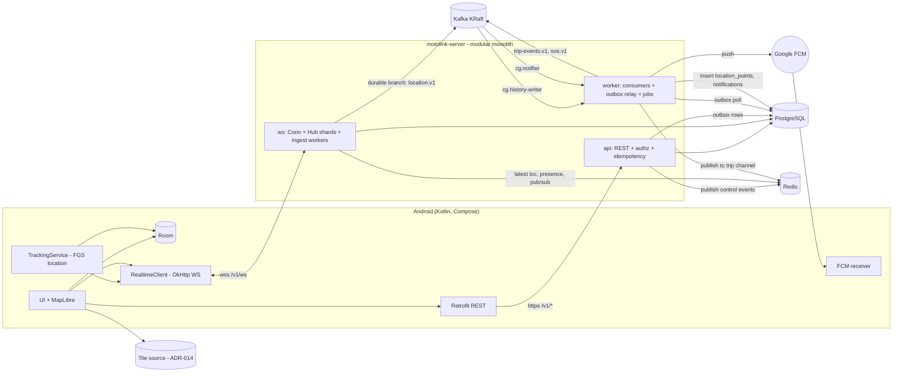
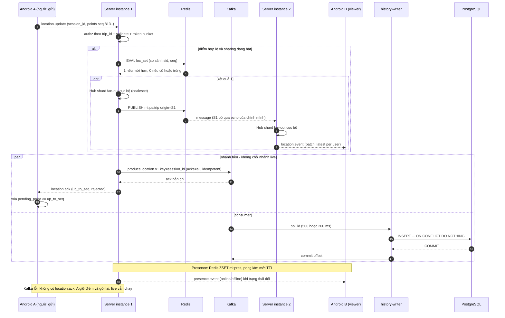
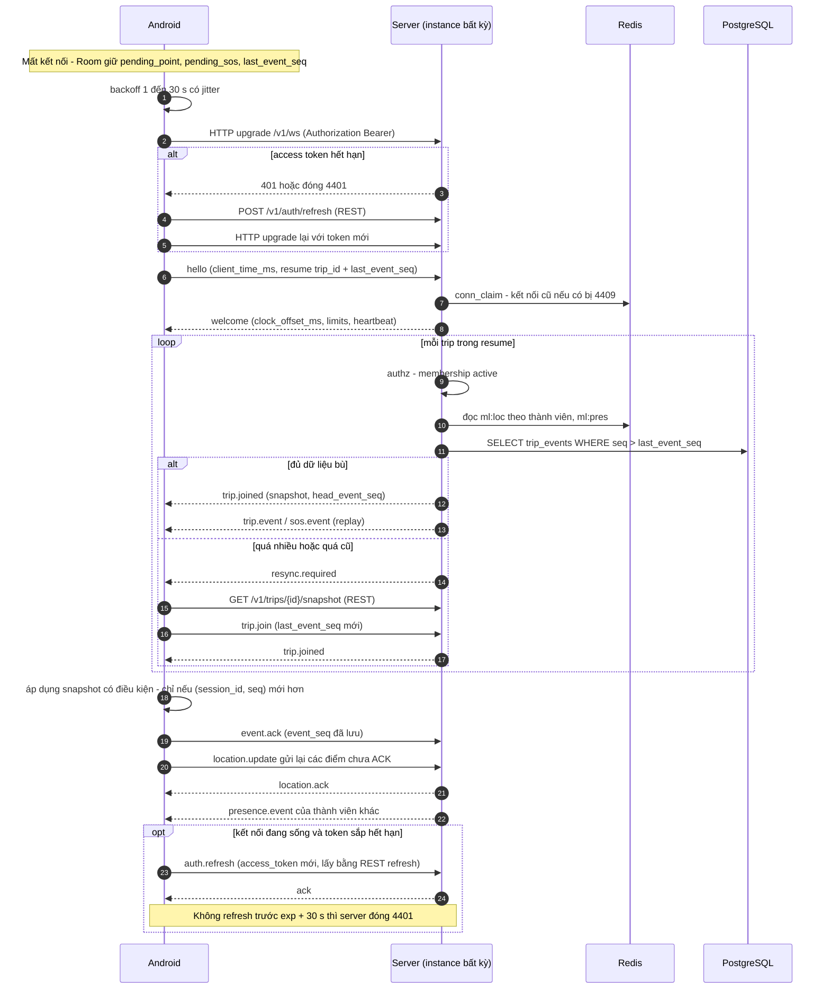
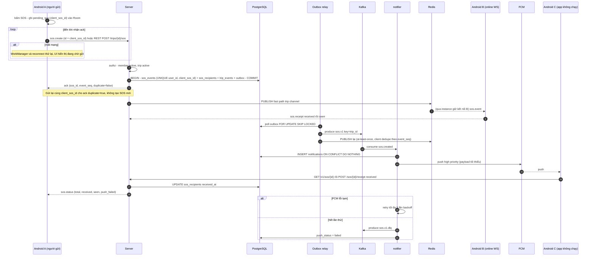
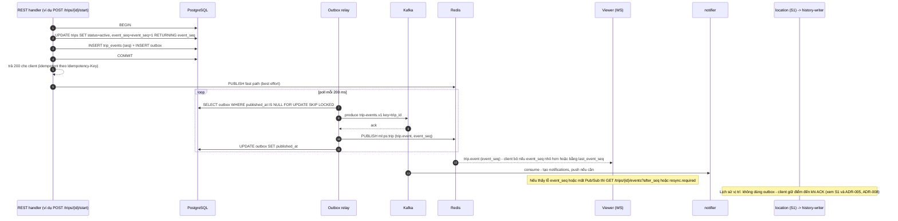

# 03 — Sơ đồ kiến trúc và sequence

Tham chiếu: ADR-001, 005, 006, 008, 011, 015. Tên message theo `07`; key theo `08`; topic theo `09`. Cú pháp Mermaid được kiểm ở Phase D (ghi kết quả ở `00-README.md`).

## 1. Sơ đồ tổng thể

Phân vai dữ liệu: vị trí live → Redis; lịch sử → Kafka rồi PostgreSQL; trip event/SOS → PostgreSQL (nguồn sự thật) + outbox → Kafka + Redis Pub/Sub.

## 2. S1 — Location update (live + bền, hai instance)

## 3. S2 — Reconnect và resume

## 4. S3 — SOS (kể cả khi người gửi mất mạng, người nhận không chạy app)

## 5. S4 — Persistence của event (trip event qua outbox, và nhánh lịch sử vị trí)

## 6. Ghi chú đọc sơ đồ

- S1 hiển thị rõ **hai nhánh độc lập**: live không chờ Kafka, ACK chỉ phụ thuộc Kafka.
- S4 nêu nguyên tắc: *event bền* đi theo outbox (at-least-once, consumer idempotent theo `event_id`/`event_seq`); *vị trí* không đi outbox.
- Mọi mũi tên "PUBLISH" là Pub/Sub không bền; sơ đồ S2 là đường bù khi mất.
