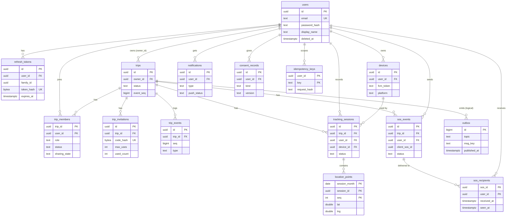

# 05 — Data model (ERD + DDL phác thảo)

Tham chiếu: ADR-004 (định danh), ADR-008 (outbox), ADR-010 (PG, partition, retention), ADR-012 (máy trạng thái), ADR-015 (SOS), ADR-016 (consent).
DDL dưới đây là **phác thảo để chốt tên/kiểu/ràng buộc**, không phải migration cuối cùng. Phiên bản PostgreSQL `[CẦN XÁC NHẬN]` (yêu cầu tối thiểu: hỗ trợ declarative partitioning, `FOR UPDATE SKIP LOCKED`, `ON CONFLICT` — có từ PG ≥ 11/9.5).

## 1. Quy ước

- PK: `uuid` (UUIDv7 do app sinh; `DEFAULT` không đặt ở DB). Thời gian: `timestamptz` (UTC). Chuỗi enum: `text` + `CHECK` (dễ migrate hơn `ENUM` type).
- Mọi bảng có `created_at`; bảng thay đổi có `updated_at`.
- Xóa: *soft delete* chỉ cho `users` (`deleted_at`, để hoàn tất xóa dữ liệu phụ thuộc theo job); các bảng khác xóa cứng theo retention.
- Tọa độ: `lat double precision` `[-90,90]`, `lng double precision` `[-180,180]` (CHECK).

## 2. ERD



Ghi chú: `outbox` không có FK cứng đến `trips` (có thể giữ sau khi trip bị xóa); quan hệ chỉ mang tính logic.

## 3. DDL phác thảo

```sql
-- ===== Danh tính =====
CREATE TABLE users (
  id              uuid PRIMARY KEY,
  email           text NOT NULL,
  email_verified  boolean NOT NULL DEFAULT false,
  password_hash   text,                       -- argon2id; NULL nếu sau này chỉ đăng nhập qua Google/Facebook
  display_name    text NOT NULL CHECK (char_length(display_name) BETWEEN 1 AND 50),
  avatar_color    text NOT NULL DEFAULT '#2E7D32',
  locale          text NOT NULL DEFAULT 'vi',
  created_at      timestamptz NOT NULL DEFAULT now(),
  updated_at      timestamptz NOT NULL DEFAULT now(),
  deleted_at      timestamptz                 -- soft delete; job xóa dữ liệu phụ thuộc
);
CREATE UNIQUE INDEX users_email_uk ON users (lower(email)) WHERE deleted_at IS NULL;
-- Đăng nhập Google/Facebook (sau MVP): bảng auth_identities(provider, subject, user_id) thêm bằng migration, xem ADR-003.

CREATE TABLE refresh_tokens (
  id            uuid PRIMARY KEY,
  user_id       uuid NOT NULL REFERENCES users(id) ON DELETE CASCADE,
  device_id     uuid,                          -- thiết bị phát hành (có thể NULL)
  family_id     uuid NOT NULL,                 -- một chuỗi xoay vòng
  token_hash    bytea NOT NULL,                -- SHA-256
  issued_at     timestamptz NOT NULL DEFAULT now(),
  expires_at    timestamptz NOT NULL,
  rotated_at    timestamptz,                   -- đã đổi sang token mới
  revoked_at    timestamptz,
  user_agent    text
);
CREATE UNIQUE INDEX refresh_tokens_hash_uk ON refresh_tokens (token_hash);
CREATE INDEX refresh_tokens_user_idx   ON refresh_tokens (user_id);
CREATE INDEX refresh_tokens_family_idx ON refresh_tokens (family_id);
CREATE INDEX refresh_tokens_expiry_idx ON refresh_tokens (expires_at); -- job dọn dẹp

CREATE TABLE devices (
  id             uuid PRIMARY KEY,             -- device_id do client sinh
  user_id        uuid NOT NULL REFERENCES users(id) ON DELETE CASCADE,
  platform       text NOT NULL DEFAULT 'android' CHECK (platform IN ('android')),
  model          text,
  os_version     text,
  app_version    text,
  has_gms        boolean NOT NULL DEFAULT true,
  fcm_token      text,
  fcm_updated_at timestamptz,
  last_seen_at   timestamptz,
  created_at     timestamptz NOT NULL DEFAULT now()
);
CREATE INDEX devices_user_idx ON devices (user_id);
CREATE UNIQUE INDEX devices_fcm_uk ON devices (fcm_token) WHERE fcm_token IS NOT NULL;

-- ===== Trip =====
CREATE TABLE trips (
  id             uuid PRIMARY KEY,
  owner_id       uuid NOT NULL REFERENCES users(id),
  name           text NOT NULL CHECK (char_length(name) BETWEEN 1 AND 80),
  status         text NOT NULL DEFAULT 'draft'
                 CHECK (status IN ('draft','active','ended','archived')),
  history_visibility text NOT NULL DEFAULT 'members'
                 CHECK (history_visibility IN ('members','self_only')),
  max_members    int  NOT NULL DEFAULT 15 CHECK (max_members BETWEEN 2 AND 15),
  event_seq      bigint NOT NULL DEFAULT 0,    -- bộ đếm trip_events.seq (tăng trong cùng transaction)
  started_at     timestamptz,
  ended_at       timestamptz,
  archived_at    timestamptz,
  created_at     timestamptz NOT NULL DEFAULT now(),
  updated_at     timestamptz NOT NULL DEFAULT now()
);
CREATE INDEX trips_owner_idx  ON trips (owner_id);
CREATE INDEX trips_status_idx ON trips (status) WHERE status IN ('draft','active');

CREATE TABLE trip_members (
  trip_id        uuid NOT NULL REFERENCES trips(id) ON DELETE CASCADE,
  user_id        uuid NOT NULL REFERENCES users(id) ON DELETE CASCADE,
  role           text NOT NULL CHECK (role IN ('owner','member')),
  status         text NOT NULL CHECK (status IN ('active','left','removed')),
  sharing_state  text NOT NULL DEFAULT 'sharing' CHECK (sharing_state IN ('sharing','paused')),
  share_history  boolean NOT NULL DEFAULT true,   -- cho phép thành viên khác xem tuyến của mình
  color          text,
  joined_at      timestamptz NOT NULL DEFAULT now(),
  left_at        timestamptz,
  PRIMARY KEY (trip_id, user_id)
);
CREATE INDEX trip_members_user_idx ON trip_members (user_id, status);
-- đúng một owner active mỗi trip
CREATE UNIQUE INDEX trip_one_owner_uk ON trip_members (trip_id) WHERE role='owner' AND status='active';

CREATE TABLE trip_invitations (
  id           uuid PRIMARY KEY,
  trip_id      uuid NOT NULL REFERENCES trips(id) ON DELETE CASCADE,
  created_by   uuid NOT NULL REFERENCES users(id),
  code_hash    bytea NOT NULL,                  -- SHA-256(code); code 8 ký tự Crockford base32 (~40 bit) hiển thị một lần
  expires_at   timestamptz NOT NULL,
  max_uses     int NOT NULL DEFAULT 15 CHECK (max_uses BETWEEN 1 AND 50),
  used_count   int NOT NULL DEFAULT 0,
  revoked_at   timestamptz,
  created_at   timestamptz NOT NULL DEFAULT now(),
  CHECK (used_count <= max_uses)
);
CREATE UNIQUE INDEX trip_invitations_code_uk ON trip_invitations (code_hash);
CREATE INDEX trip_invitations_trip_idx ON trip_invitations (trip_id);

-- Nhật ký sự kiện bền theo trip (nguồn cho cursor event_seq, ADR-011)
CREATE TABLE trip_events (
  id           uuid PRIMARY KEY,                -- event_id
  trip_id      uuid NOT NULL REFERENCES trips(id) ON DELETE CASCADE,
  seq          bigint NOT NULL,                 -- = trips.event_seq tại thời điểm ghi
  type         text NOT NULL,                   -- xem 07 mục "trip.event types"
  actor_id     uuid REFERENCES users(id) ON DELETE SET NULL,
  payload      jsonb NOT NULL DEFAULT '{}',
  created_at   timestamptz NOT NULL DEFAULT now(),
  UNIQUE (trip_id, seq)
);

-- ===== Tracking =====
CREATE TABLE tracking_sessions (
  id              uuid PRIMARY KEY,             -- session_id, server cấp (UUIDv7)
  trip_id         uuid NOT NULL REFERENCES trips(id) ON DELETE CASCADE,
  user_id         uuid NOT NULL REFERENCES users(id) ON DELETE CASCADE,
  device_id       uuid REFERENCES devices(id) ON DELETE SET NULL,
  status          text NOT NULL DEFAULT 'active' CHECK (status IN ('active','paused','ended')),
  end_reason      text CHECK (end_reason IN ('user','trip_ended','removed','timeout','account_deleted')),
  session_month   date NOT NULL,                -- date_trunc('month', started_at)::date, dùng cho partition
  started_at      timestamptz NOT NULL DEFAULT now(),
  paused_total_s  int NOT NULL DEFAULT 0,
  ended_at        timestamptz,
  last_seq        int NOT NULL DEFAULT 0,       -- seq lớn nhất server đã thấy (cập nhật lười, ~mỗi 30 s)
  last_seen_at    timestamptz,
  -- thống kê (idempotent recompute, xem 09 consumer stats)
  point_count     int,
  distance_m      double precision,
  duration_s      int,
  stats_version   int NOT NULL DEFAULT 0,       -- tăng mỗi lần recompute
  route_polyline  text                          -- encoded polyline đã đơn giản hóa; sau downsampling
);
CREATE INDEX tracking_sessions_trip_idx ON tracking_sessions (trip_id, started_at);
CREATE INDEX tracking_sessions_user_idx ON tracking_sessions (user_id, started_at DESC);
-- tối đa một session chưa kết thúc cho mỗi (user, trip)
CREATE UNIQUE INDEX tracking_sessions_one_open_uk ON tracking_sessions (trip_id, user_id)
  WHERE status IN ('active','paused');

-- Lịch sử điểm: partition theo tháng của session_month (ADR-010)
CREATE TABLE location_points (
  session_month  date        NOT NULL,
  session_id     uuid        NOT NULL,          -- không FK (partitioned + hiệu năng); toàn vẹn do consumer kiểm tra
  seq            int         NOT NULL,
  trip_id        uuid        NOT NULL,
  user_id        uuid        NOT NULL,
  recorded_at    timestamptz NOT NULL,          -- client_ts + clock_offset, đã clamp (ADR-004)
  received_at    timestamptz NOT NULL,          -- server_received_ts
  lat            double precision NOT NULL CHECK (lat BETWEEN -90 AND 90),
  lng            double precision NOT NULL CHECK (lng BETWEEN -180 AND 180),
  accuracy_m     real,
  speed_mps      real,
  heading_deg    real,
  altitude_m     real,
  suspect        boolean NOT NULL DEFAULT false,
  PRIMARY KEY (session_month, session_id, seq)
) PARTITION BY RANGE (session_month);
-- ví dụ: CREATE TABLE location_points_2026_10 PARTITION OF location_points
--          FOR VALUES FROM ('2026-10-01') TO ('2026-11-01');
CREATE INDEX location_points_user_time_idx ON location_points (user_id, recorded_at); -- phục vụ xóa theo user

-- ===== SOS =====
CREATE TABLE sos_events (
  id               uuid PRIMARY KEY,
  trip_id          uuid NOT NULL REFERENCES trips(id) ON DELETE CASCADE,
  user_id          uuid NOT NULL REFERENCES users(id) ON DELETE CASCADE,
  client_sos_id    uuid NOT NULL,
  kind             text NOT NULL DEFAULT 'general'
                   CHECK (kind IN ('general','accident','breakdown','lost','medical')),
  message          text CHECK (char_length(message) <= 280),
  lat              double precision,
  lng              double precision,
  accuracy_m       real,
  client_created_at timestamptz,
  status           text NOT NULL DEFAULT 'open' CHECK (status IN ('open','resolved','cancelled')),
  resolved_by      uuid REFERENCES users(id) ON DELETE SET NULL,
  resolved_at      timestamptz,
  created_at       timestamptz NOT NULL DEFAULT now(),
  UNIQUE (user_id, client_sos_id)
);
CREATE INDEX sos_events_trip_idx ON sos_events (trip_id, created_at DESC);

CREATE TABLE sos_recipients (
  sos_id            uuid NOT NULL REFERENCES sos_events(id) ON DELETE CASCADE,
  user_id           uuid NOT NULL REFERENCES users(id) ON DELETE CASCADE,
  delivered_ws_at   timestamptz,       -- server đã đẩy qua WS
  delivered_push_at timestamptz,       -- FCM chấp nhận gửi (KHÔNG đồng nghĩa thiết bị nhận)
  push_status       text CHECK (push_status IN ('pending','sent','failed','no_token')),
  received_at       timestamptz,       -- client ACK đã nhận
  seen_at           timestamptz,       -- người dùng đã mở
  PRIMARY KEY (sos_id, user_id)
);
CREATE INDEX sos_recipients_user_idx ON sos_recipients (user_id, seen_at);

-- ===== Thông báo / tiện ích =====
CREATE TABLE notifications (
  id           uuid PRIMARY KEY,
  user_id      uuid NOT NULL REFERENCES users(id) ON DELETE CASCADE,
  trip_id      uuid REFERENCES trips(id) ON DELETE CASCADE,
  type         text NOT NULL,                    -- member_joined, trip_started, trip_ended, sos, ...
  ref_event_id uuid,                             -- trip_events.id hoặc sos_events.id, dùng làm khóa idempotent
  payload      jsonb NOT NULL DEFAULT '{}',
  push_status  text CHECK (push_status IN ('pending','sent','failed','skipped')),
  push_attempts int NOT NULL DEFAULT 0,
  created_at   timestamptz NOT NULL DEFAULT now(),
  read_at      timestamptz,
  UNIQUE (user_id, type, ref_event_id)
);
CREATE INDEX notifications_user_idx ON notifications (user_id, created_at DESC);

CREATE TABLE consent_records (
  id          uuid PRIMARY KEY,
  user_id     uuid NOT NULL REFERENCES users(id) ON DELETE CASCADE,
  kind        text NOT NULL CHECK (kind IN ('location_processing','privacy_policy','terms','background_location')),
  version     text NOT NULL,                     -- phiên bản văn bản
  granted_at  timestamptz NOT NULL DEFAULT now(),
  withdrawn_at timestamptz
);
CREATE INDEX consent_user_idx ON consent_records (user_id, kind, granted_at DESC);

CREATE TABLE idempotency_keys (
  user_id        uuid NOT NULL REFERENCES users(id) ON DELETE CASCADE,
  key            text NOT NULL,
  method         text NOT NULL,
  path           text NOT NULL,
  request_hash   bytea NOT NULL,                  -- SHA-256 của body chuẩn hóa
  response_status int,
  response_body  jsonb,
  created_at     timestamptz NOT NULL DEFAULT now(),
  expires_at     timestamptz NOT NULL,            -- now() + 24h
  PRIMARY KEY (user_id, key)
);
CREATE INDEX idempotency_expiry_idx ON idempotency_keys (expires_at);

-- ===== Outbox (ADR-008) =====
CREATE TABLE outbox (
  id            bigserial PRIMARY KEY,
  topic         text NOT NULL,
  msg_key       text NOT NULL,                    -- partition key (trip_id)
  event_id      uuid NOT NULL,                    -- idempotency cho consumer
  payload       jsonb NOT NULL,
  created_at    timestamptz NOT NULL DEFAULT now(),
  published_at  timestamptz
);
CREATE INDEX outbox_unpublished_idx ON outbox (id) WHERE published_at IS NULL;
```

## 4. Transaction quan trọng

| # | Thao tác | Transaction (cùng một `BEGIN … COMMIT`) | Ghi chú đồng thời |
|---|---|---|---|
| T1 | Đăng ký | insert `users` (+ `consent_records` terms/privacy) | Unique email chặn trùng |
| T2 | Refresh token | `SELECT … FOR UPDATE` theo `token_hash`; nếu `rotated_at` hoặc `revoked_at` đã set → thu hồi cả `family_id` (phát hiện tái sử dụng); ngược lại set `rotated_at`, insert token mới | Hai request đồng thời cùng token: một thắng, một bị coi là tái sử dụng → client xử lý bằng cách dùng token mới từ lần thành công (hoặc đăng nhập lại) |
| T3 | Tạo trip | insert `trips` (draft) + `trip_members` (owner) + `trip_events(trip_created)` | |
| T4 | Tham gia bằng mã | `SELECT … FROM trip_invitations WHERE code_hash=$1 FOR UPDATE`; kiểm tra hạn/lượt/revoked; kiểm tra trip chưa `ended`; đếm member active < `max_members` (khóa `trips` row `FOR UPDATE`); upsert `trip_members`; `used_count+1`; ghi `trip_events(member_joined)` + `outbox` | Khóa hàng `trips` để chống vượt `max_members` |
| T5 | Ghi trip event | `UPDATE trips SET event_seq=event_seq+1 WHERE id=$1 RETURNING event_seq` → insert `trip_events(seq)` + `outbox` | Cùng hàng `trips` → tuần tự hóa theo trip, `seq` liền mạch không lỗ (nếu rollback thì bộ đếm cũng rollback) |
| T6 | Start/End trip | đổi `trips.status` có điều kiện (`WHERE status='draft'`) + T5; khi `end`: kết thúc mọi `tracking_sessions` còn mở (`end_reason='trip_ended'`) | |
| T7 | Bắt đầu tracking | kiểm tra member active + trip `active` + consent; insert `tracking_sessions` (unique partial index chặn 2 session mở) | |
| T8 | Gửi SOS | insert `sos_events` (ON CONFLICT `(user_id, client_sos_id)` → trả bản cũ) + `sos_recipients` (mọi member active trừ người gửi) + T5 + `outbox` | Idempotent |
| T9 | Xóa tài khoản | xem §6 | Nhiều bước, có job |

## 5. Máy trạng thái

### Trip
| Từ | Sang | Điều kiện | Ai | Hiệu ứng |
|---|---|---|---|---|
| — | `draft` | tạo | user đã đăng nhập | owner tự thành member |
| `draft` | `active` | ≥ 1 member (chỉ owner cũng được) | owner | `started_at`; event `trip_started` |
| `active` | `ended` | — | owner; hoặc job auto-end (24 giờ không có session mở) | kết thúc mọi session; DEL Redis vị trí; event `trip_ended` |
| `draft` | `ended` | hủy chuyến chưa bắt đầu | owner | |
| `ended` | `archived` | — | owner; job sau 30 ngày | ẩn khỏi danh sách mặc định; không nhận event mới |
Mọi chuyển trạng thái khác bị từ chối (`409 invalid_state`). Không có `paused` cấp trip (ADR-012, ADR-020).

### Tracking session
| Từ | Sang | Ai | Ghi chú |
|---|---|---|---|
| — | `active` | chủ session | Trip phải `active`; membership `active` |
| `active` | `paused` | chủ session | Không nhận `location.update` (server từ chối `session_paused`) |
| `paused` | `active` | chủ session | Cùng `session_id`, `seq` tiếp tục |
| `active`/`paused` | `ended` | chủ session; server (`trip_ended`, `removed`, `timeout`, `account_deleted`) | `timeout`: không có kết nối/heartbeat > 10 phút `[GIẢ ĐỊNH]`; kích hoạt tính thống kê |

### Membership
| Từ | Sang | Ai |
|---|---|---|
| — | `active` | tham gia bằng mã / owner tạo trip |
| `active` | `left` | chính member (owner chỉ khi đã chuyển quyền) |
| `active` | `removed` | owner |
Sharing (`sharing`⇄`paused`) là thuộc tính trực giao, do chính member đổi.

## 6. Quy tắc xóa và lưu trữ

| Dữ liệu | Quy tắc |
|---|---|
| `location_points` thô | Giữ 30 ngày sau `ended_at` của session `[GIẢ ĐỊNH]`; sau đó job (`retention`) downsample → `tracking_sessions.route_polyline`, xóa điểm thô bằng `DELETE … WHERE session_id` hoặc `DROP PARTITION` khi cả partition hết hạn (90 ngày) |
| `tracking_sessions`, `trip_events` | Giữ đến khi trip bị xóa (trip `archived` > 365 ngày `[GIẢ ĐỊNH]` → xóa cứng trip, CASCADE) |
| Redis vị trí | TTL (xem `08`); xóa khi session/trip kết thúc |
| `refresh_tokens` | Xóa sau `expires_at + 7d` |
| `idempotency_keys` | Xóa sau `expires_at` |
| `outbox` | Xóa dòng `published_at < now() − 7d` |
| `notifications` | 90 ngày |
| `consent_records` | Giữ theo yêu cầu pháp lý chứng minh sự đồng ý `[CẦN XÁC NHẬN]` — **không** xóa khi user xóa tài khoản trừ khi luật sư xác nhận |
| **Xóa tài khoản** (`DELETE /v1/me`) | (1) `users.deleted_at=now()`, thu hồi mọi refresh token, đóng WS; (2) rời mọi trip (owner phải chuyển quyền hoặc trip bị `ended`); (3) job xóa `location_points` theo `user_id` (index `location_points_user_time_idx`), `sos_events.user_id` là `ON DELETE CASCADE` (xóa cùng người gửi) — ưu tiên quyền xóa, đánh đổi: thành viên khác mất bản ghi SOS cũ; (4) xóa `devices`; (5) email/tên bị xóa khỏi `users` (hoặc xóa hàng) sau khi mọi tham chiếu đã dọn |

## 7. Khi nào cần PostGIS (ghi nhận quyết định ADR-010)

Cần khi có: geofence/vùng cảnh báo, truy vấn "thành viên cách nhau > X km" trong SQL, map-matching, tìm POI gần. Chưa có → dùng `lat/lng` + haversine ở Go. Index không gian không cần vì không truy vấn theo vị trí. Nếu thêm: `CREATE EXTENSION postgis`, cột `geography(Point,4326)` sinh từ `lat/lng`, đổi ảnh Docker.

## 8. Ước tính kích thước (xem `13` cho tính toán đầy đủ)

Một dòng `location_points` ≈ 90–110 B heap + ≈ 45 B index PK (`[GIẢ ĐỊNH]`, đo ở M5) → ~150 B/điểm.

## 9. Truy xuất: bảng ↔ endpoint/consumer (phục vụ checklist 0.6)

| Bảng | Dùng bởi |
|---|---|
| `users` | `POST /v1/auth/register`, `/login`, `GET/PATCH/DELETE /v1/me` |
| `refresh_tokens` | `/v1/auth/refresh`, `/logout`, `/logout-all` |
| `devices` | `PUT/DELETE /v1/devices/{id}`; notifier consumer (lấy FCM token) |
| `trips` | `POST/GET/PATCH /v1/trips…`, start/end/archive; job auto-end |
| `trip_members` | join/leave/remove, `GET members`, `PATCH members/me`; mọi kiểm quyền |
| `trip_invitations` | `POST/GET/DELETE …/invitations`, `POST /v1/trip-join`, `POST /v1/invitations/resolve` |
| `trip_events` | `GET /v1/trips/{id}/events`; WS replay; outbox relay |
| `tracking_sessions` | `POST/…/tracking-sessions…`; stats consumer; retention job |
| `location_points` | `GET …/route`, `POST …/points` (REST fallback), history-writer consumer, stats consumer, retention job |
| `sos_events`, `sos_recipients` | `POST/GET /v1/trips/{id}/sos`, `/v1/sos/{id}/ack`, `/resolve`; notifier consumer |
| `notifications` | `GET /v1/notifications`, `POST /v1/notifications/read`; notifier consumer |
| `consent_records` | `PUT /v1/me/consents`, `GET /v1/me/consents`, kiểm tra ở T7 |
| `idempotency_keys` | middleware Idempotency cho mọi `POST` ghi quan trọng |
| `outbox` | outbox relay (worker); mọi giao dịch T4–T8 |
