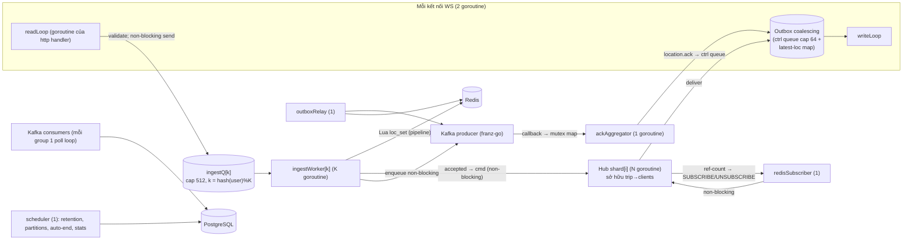
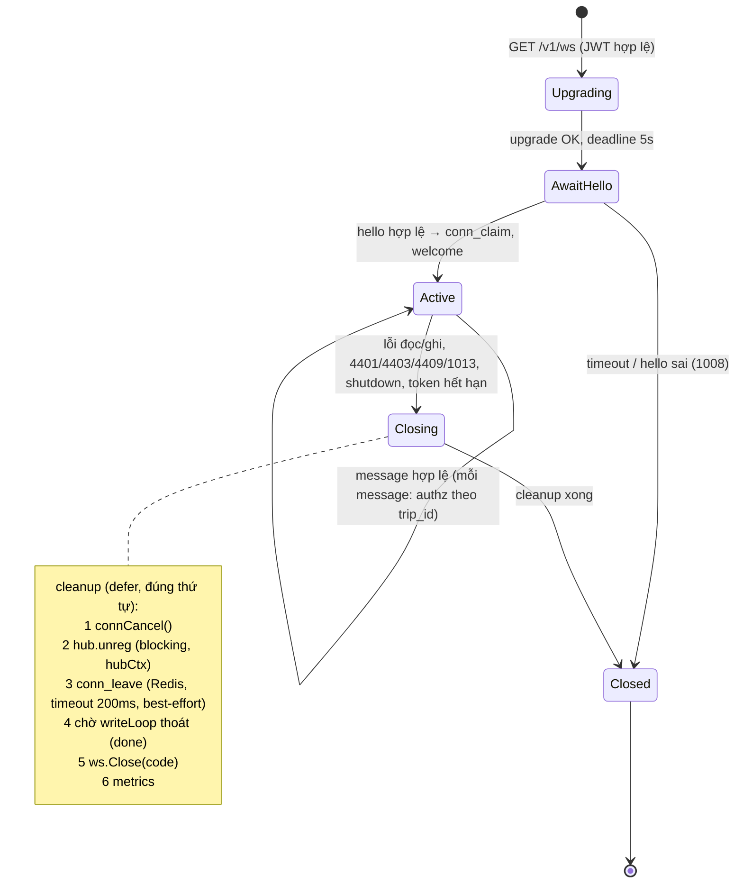

# 10 — Concurrency model và vòng đời goroutine/channel

Tham chiếu: ADR-005, ADR-006, ADR-009; `07` (giao thức), `08` (Redis), `09` (Kafka). Đây là tài liệu trung tâm về Go concurrency. Pseudo-code chỉ minh họa cấu trúc, không phải implementation.

## 1. Nguyên tắc

1. **Mọi goroutine có chủ (owner)**, có `context` hủy được, có điều kiện thoát, và được `Wait` khi shutdown (`errgroup`/`sync.WaitGroup` của owner). Không `go f()` "bắn rồi quên".
2. **Không goroutine theo từng message.** Số goroutine = hằng số (shard, worker, consumer…) + 2 mỗi kết nối WS (+ goroutine của `net/http` mỗi request REST, bị chặn bởi giới hạn kết nối).
3. **Người gửi (producer) là người đóng channel**, và chỉ khi nó là *người gửi duy nhất*. Channel nhiều người gửi **không bao giờ đóng**; dùng `context`/kênh `done` để báo dừng. Không close channel từ phía nhận.
4. **Mọi channel có capacity hữu hạn** và chính sách đầy được định nghĩa (bảng §4).
5. **Dữ liệu chia sẻ** chỉ thuộc một goroutine sở hữu (single-owner) hoặc là immutable sau khi gửi đi. Message gửi qua channel là value/immutable (không sửa sau khi gửi).
6. `go test -race` bắt buộc ở CI; test rò rỉ goroutine (`goleak`) ở mức tích hợp.
7. Mọi entry point goroutine bọc `recover` → log (không có tọa độ), tăng metric `goroutine_panics_total{name}`; panic trong goroutine kết nối chỉ đóng kết nối đó; panic trong goroutine hạ tầng (hub shard, subscriber) làm process thoát có kiểm soát (supervisor khởi động lại bởi Docker `restart: unless-stopped`) vì trạng thái đã không tin cậy.

## 2. Bản đồ tổng thể



## 3. Danh mục goroutine

| # | Goroutine | Số lượng | Ai tạo | Ai sở hữu / chờ | Ai đóng channel | Điều kiện thoát | Context |
|---|---|---|---|---|---|---|---|
| G0 | `main` / supervisor | 1 | runtime | — | — | `SIGTERM`/`SIGINT` hoặc lỗi nghiêm trọng | Tạo `rootCtx` (`signal.NotifyContext`); hủy ⇒ bắt đầu shutdown tuần tự (§7) |
| G1 | HTTP server (API + `/v1/ws` upgrade) | goroutine/request do `net/http` | `http.Server` | `http.Server` (`Shutdown(ctx)`) | — | Request xong / `Shutdown` | `r.Context()` có timeout 10 s (REST); WS: xem G3 |
| G2 | **Hub shard** `i ∈ [0,N)` | N (= `GOMAXPROCS`, tối đa 8) | `Hub.Start` | `Hub` (WaitGroup) | `Hub` đóng `shard.cmds` **sau khi** mọi người gửi đã dừng (ingestWorker, subscriber, readLoop đã Wait) | `ctx.Done()` ⇒ gửi `closing` cho client, đóng, thoát | `hubCtx` ← `rootCtx` |
| G3 | **WS `readLoop`** (chính là goroutine handler sau upgrade) | 1/kết nối | `net/http` | `ws.Conn` (defer cleanup) | — | Lỗi đọc, đóng bởi peer, `connCtx.Done()`, vi phạm giao thức, hết hạn token | `connCtx` ← `rootCtx`; hủy khi đóng |
| G4 | **WS `writeLoop`** | 1/kết nối | `readLoop` trước khi vào vòng lặp | `ws.Conn` (chờ qua `done`) | Chỉ `ws.Conn` đóng `done` (một lần, `sync.Once`) | `done` đóng hoặc lỗi ghi/timeout ghi (10 s) | `connCtx` |
| G5 | `ingestWorker[k]` | K = 4 (cấu hình) | `Ingest.Start` | `Ingest` | `Ingest` đóng `ingestQ[k]` sau khi mọi `readLoop` đã dừng (xem §7) | `ingestQ[k]` đóng và rỗng | `ingestCtx` ← `rootCtx` (nhưng **drain** trước khi dừng) |
| G6 | `redisSubscriber` | 1/instance | `Hub.Start` | `Hub` | Không có channel nhận từ nhiều người gửi: nhận lệnh `(un)subscribe` qua `subCmds` có người gửi là các shard ⇒ **không đóng**, dùng `ctx` | `ctx.Done()` ⇒ `pubsub.Close()` | `hubCtx` |
| G7 | `presenceJanitor` | 1/instance | `Hub.Start` | `Hub` | — | `ctx.Done()` | `hubCtx` |
| G8 | `ackAggregator` | 1/instance | `Ingest.Start` | `Ingest` | — | `ctx.Done()` sau flush cuối | `ingestCtx` |
| G9 | Kafka producer (franz-go) | goroutine nội bộ thư viện | `kgo.NewClient` | `Ingest`/`Relay` (`client.Close()`, `Flush(ctx)`) | — | `Close()` | — |
| G10 | `historyWriter` consumer poll loop | 1/group/instance | `Worker.Start` | `Worker` | — | `ctx.Done()` ⇒ xử lý nốt lô, commit, `LeaveGroup` | `workerCtx` |
| G11 | `notifier` poll loop + pool ≤ 8 goroutine gọi FCM theo lô | 1 + 8 | `Worker.Start` | `Worker`; pool sở hữu bởi hàm xử lý lô (`errgroup.SetLimit(8)` — kết thúc trước khi hàm trả về) | — | như G10 | `workerCtx`, timeout 10 s mỗi lời gọi FCM |
| G12 | `outboxRelay` | 1 | `Worker.Start` | `Worker` | — | `ctx.Done()` | `workerCtx` |
| G13 | `scheduler` (retention, partition, auto-end, stats) | 1 (task chạy tuần tự, lấy `ml:lock:<job>`) | `Worker.Start` | `Worker` | — | `ctx.Done()` | `workerCtx` |
| G14 | metrics/health HTTP | 1 | `main` | `main` | — | `Shutdown` | `rootCtx` |

Tổng goroutine cố định ≈ `N + K + 10` (≈ 25). Với 500 kết nối: ≈ 1 025 goroutine; bộ nhớ ước ≈ 20–40 KiB/kết nối (stack + buffer đọc/ghi WS + outbox) ⇒ 10–20 MiB `[GIẢ ĐỊNH, đo ở M3]`.

## 4. Channel: capacity và chính sách khi đầy

| Channel | Capacity | Người gửi → nhận | Khi đầy |
|---|---|---|---|
| `shard.cmds` (lệnh join/leave/control) | 1 024 | readLoop/subscriber/worker → shard | **Chặn có thời hạn** (`select` với `ctx.Done()` + timeout 1 s). Hết hạn ⇒ lỗi `server_busy` cho join; **leave/unregister không được bỏ**: dùng kênh riêng `shard.unreg` cap 4 096, gửi blocking trong ngữ cảnh `hubCtx` (không bị hủy bởi `connCtx`) |
| `shard.loc` (fan-out vị trí) | 4 096 | ingestWorker/subscriber → shard | **Non-blocking, bỏ bản mới nếu đầy** + `dropped_total{reason="shard_full"}` (vị trí ephemeral; bản kế tiếp thay thế) |
| `ingestQ[k]` | 512 | readLoop → ingestWorker | **Non-blocking**; đầy ⇒ từ chối frame bằng `error{server_busy}` (không ACK) ⇒ client gửi lại |
| `client.ctrl` (outbox điều khiển) | 64 | shard/handler → writeLoop | Đầy ⇒ coi là **slow consumer**: đóng kết nối `1013`; client resume bằng `event_seq` (không mất dữ liệu bền) |
| `client.latestLoc` | map, tối đa `members−1` phần tử | shard → writeLoop | Ghi đè theo user (drop-oldest tự nhiên) |
| `subCmds` | 256 | shard → subscriber | Chặn có thời hạn; hết hạn ⇒ log + retry nội bộ (lệnh subscribe được lập lại từ ref-count định kỳ 30 s để tự lành) |
| `done` (mỗi conn) | đóng một lần | `ws.Conn` | — |

## 5. Hub

### 5.1 Vì sao shard single-owner (ADR-009)

| Phương án | Ưu | Nhược |
|---|---|---|
| Mutex toàn cục quanh map | Đơn giản | Contention khi fan-out; giữ lock trong lúc gửi dễ gây deadlock/độ trễ; khó đảm bảo không chặn khi client chậm |
| Một goroutine hub | Không lock | Nút cổ chai ở tải cao; một trip nặng làm chậm tất cả |
| **Shard × single-owner (chọn)** | Không lock trên đường nóng; cách ly theo shard; suy luận được; mở rộng theo core | Phải định tuyến theo `hash(trip)`; cache membership phân tán theo shard |
| Mutex nhỏ theo trip (`sync.Map`) | Linh hoạt | Dễ sai; khó giới hạn tài nguyên và test |

Chọn: shard + owner. **Kết hợp** một chút mutex chỉ ở nơi cần đọc từ nhiều goroutine (bộ đếm metric dùng `atomic`).

### 5.2 Vòng lặp shard (minh họa)

```go
func (s *shard) run(ctx context.Context) {
    for {
        select {
        case <-ctx.Done():
            s.shutdown()
            return
        case c := <-s.cmds:          // join, leave, membership_changed, control
            s.handle(c)               // sửa map trips[tripID].clients, ref-count; không chặn
        case u := <-s.unreg:          // client đã đóng
            s.remove(u)
        case l := <-s.loc:            // l = vị trí đã được chấp nhận bởi Lua (hoặc từ Pub/Sub)
            for _, cl := range s.trips[l.tripID].clients {
                if cl.userID != l.userID && cl.sharingAllowed(l) {
                    cl.out.putLatest(l)   // ghi đè bản cũ; không chặn
                }
            }
        case e := <-s.events:         // sự kiện bền
            for _, cl := range s.trips[e.tripID].clients { cl.out.pushCtrl(e) } // đầy ⇒ kick(slow)
        }
    }
}
```
`out.putLatest` và `pushCtrl` chỉ thao tác cấu trúc trong bộ nhớ có khóa riêng của `clientOutbox` (mutex ngắn: shard ghi, writeLoop đọc) rồi đánh thức writeLoop bằng channel `wake` capacity 1 (non-blocking). Shard **không bao giờ** chờ I/O của client.

### 5.3 Outbox coalescing của client (minh họa)

```go
type clientOutbox struct {
    mu     sync.Mutex
    ctrl   []Msg               // FIFO, tối đa 64
    latest map[UserID]LocMsg   // mỗi user một bản mới nhất
    wake   chan struct{}       // cap 1
}
func (o *clientOutbox) putLatest(l LocMsg) {
    o.mu.Lock()
    if cur, ok := o.latest[l.User]; !ok || l.After(cur) { o.latest[l.User] = l } // so (sid,seq)
    o.mu.Unlock()
    select { case o.wake <- struct{}{}: default: }
}
func (o *clientOutbox) pushCtrl(m Msg) (overflow bool) {
    o.mu.Lock(); defer o.mu.Unlock()
    if len(o.ctrl) >= 64 { return true }       // caller kick(client, 1013)
    o.ctrl = append(o.ctrl, m)
    select { case o.wake <- struct{}{}: default: }
    return false
}
```
`writeLoop`: chờ `wake` hoặc tick 250 ms; lấy toàn bộ `ctrl` + toàn bộ `latest` (một `location.event` gộp), ghi từng frame với `writeTimeout = 10 s`; lỗi/timeout ⇒ thoát ⇒ đóng kết nối.

### 5.4 Slow consumer

- **Vị trí**: không bao giờ tích lũy (map theo user): tối đa `members−1` phần tử mỗi client ⇒ bộ nhớ bị chặn theo cấu trúc; client chậm chỉ thấy vị trí thưa hơn (đúng ngữ nghĩa "mới nhất").
- **Sự kiện bền**: hàng đợi 64; tràn ⇒ đóng `1013`. Client reconnect + resume theo `event_seq` ⇒ nhận lại từ DB. An toàn vì sự kiện bền có nguồn sự thật trong PG.
- **Ghi chặn lâu** (TCP đầy): `writeTimeout` 10 s ⇒ đóng.
- Metric: `ws_slow_consumer_closes_total`, `ws_outbox_ctrl_depth` (histogram), `ws_location_coalesced_total` (số lần ghi đè), `ws_location_dropped_total{reason}`.

## 6. Vòng đời một kết nối



Chi tiết `readLoop` (một goroutine/kết nối): `hello` → vòng lặp `Read(ctx)` với giới hạn kích thước; mỗi message: giải mã → `authorize(msg)` → xử lý. `location.update` đi `validate` (rẻ: phạm vi, tần suất — token bucket trong bộ nhớ của kết nối) → `ingestQ[hash(user)%K]` non-blocking. Heartbeat: thư viện WS gửi ping định kỳ (server 20 s) trong `writeLoop` ticker; `pong` làm mới `conn_touch`/`pres_touch` (qua `ingestQ` điều khiển hoặc gọi trực tiếp với timeout 100 ms — chọn gọi trực tiếp, vì 1 lần/20 s/kết nối).

Hết hạn token: `readLoop` giữ timer tới `exp + 30 s`; `auth.refresh` hợp lệ reset timer. Hết giờ ⇒ đóng `4401`.

Reconnect phía server: không giữ trạng thái kết nối đã đóng (trạng thái nằm ở Room của client + Redis + PG). Kết nối mới của cùng user: `conn_claim` trả về `conn` cũ ⇒ phát `superseded` ⇒ instance giữ kết nối cũ gọi `kick(conn, 4409)`.

## 7. Shutdown tuần tự (SIGTERM)

Thời gian tối đa 25 s (Docker `stop_grace_period: 30s`).

1. `readiness=false` (Caddy/LB ngừng đưa kết nối mới), `http.Server.Shutdown` ngừng nhận request mới (REST đang chạy có tối đa 10 s).
2. Hub gửi `closing{server_shutdown, retry_after_ms: 3000 + jitter}` tới mọi client, đóng `1001` sau tối đa 3 s chờ `writeLoop` xả. Từ đây `readLoop` thoát ⇒ không còn người gửi vào `ingestQ`.
3. `Ingest`: đóng `ingestQ[k]` (người gửi duy nhất là các readLoop đã dừng — Hub Wait mọi `ws.Conn`), worker **drain** phần còn lại (tối đa 3 s).
4. `kgo.Client.Flush(ctx 5s)` cho producer; `ackAggregator` gửi lần cuối (kết nối đã đóng thì bỏ). Điểm chưa Flush ⇒ client chưa nhận ACK ⇒ gửi lại ở lần kết nối sau (ADR-005).
5. Worker: ngừng poll, xử lý nốt lô đang chạy, commit offset, rời group; relay và scheduler thoát.
6. Hub đóng `shard.cmds` và các channel (người gửi đã dừng), `subscriber.Close()`.
7. Đóng pool Redis, pool PG, metrics server. `Wait` toàn bộ; quá hạn ⇒ log danh sách goroutine (`pprof goroutine`) và thoát mã ≠ 0.

Thứ tự đảm bảo **không có người gửi vào channel đã đóng** (đóng channel luôn sau khi `Wait` mọi sender).

## 8. Backpressure đầu-cuối (tóm tắt chính sách)

| Điểm nghẽn | Phản ứng |
|---|---|
| Client đọc chậm | Coalesce vị trí; tràn ctrl ⇒ đóng `1013` |
| Shard đầy | Bỏ vị trí mới; join ⇒ `server_busy` |
| `ingestQ` đầy | Từ chối frame, không ACK ⇒ client giữ + gửi lại với backoff (`retry_after_ms` trong `error`) |
| Kafka producer đầy / Kafka chậm | Không ACK; live vẫn chạy; metric; client đệm Room |
| Redis chậm | Timeout 100 ms + circuit breaker (08 §5); live suy giảm cục bộ |
| PG chậm | Chỉ ảnh hưởng consumer ⇒ lag; không ảnh hưởng live |
| Thiết bị gửi quá nhanh | Token bucket ⇒ `rate_limited`; vi phạm nặng ⇒ `4429` |

## 9. Pipeline xử lý một frame `location.update` (kèm ranh giới goroutine)

1. `readLoop`: parse (giới hạn 16 KiB), authz (membership cache trong conn, làm tươi bởi `membership_changed`), kiểm tra session thuộc user & `active`, token bucket, validate từng điểm (§8 của `07`).
2. Điểm hợp lệ ⇒ `ingestQ[k]` non-blocking. Điểm bị từ chối vĩnh viễn ⇒ ghi vào `rejected` của `ackAggregator` (nhánh bền coi như "đã giải quyết").
3. `ingestWorker[k]` (đọc vài mục từ queue, tối đa 64 hoặc 1 ms):
   a. Nếu `sharing_state='paused'` ⇒ bỏ qua bước b–c (chỉ nhánh bền).
   b. Pipeline Redis: `loc_set` cho từng điểm (chỉ cần điểm cuối của mỗi `(session)` trong lô nếu nhiều điểm; các điểm trước vẫn gửi Kafka) + `PUBLISH` cho điểm được chấp nhận.
   c. Điểm được chấp nhận ⇒ `shard.loc` (non-blocking) để fan-out cục bộ.
   d. **Mọi** điểm hợp lệ (kể cả `loc_set` trả 0) ⇒ enqueue Kafka non-blocking; callback ⇒ `ackAggregator`.
4. `ackAggregator`: mỗi session giữ `acked` (tập hợp/bitmap các seq đã xong, từ callback + rejected) và `up_to` liên tục; mỗi ≤ 1 s nếu `up_to` tăng ⇒ `location.ack` vào `ctrl` của kết nối đó (tra qua `Hub.Lookup(conn_id)`; kết nối đã đóng ⇒ bỏ). Bộ nhớ chặn bởi số session mở (xóa khi session `ended`).
5. Nhận từ Pub/Sub (instance khác): `redisSubscriber` ⇒ `shard.loc` (non-blocking) ⇒ như bước 3c ở phía nhận (không ghi Redis lại).

Độ trễ mục tiêu ingest→viewer cùng instance: p95 < 100 ms `[GIẢ ĐỊNH — đo ở M3/M4]`.

## 10. Các điểm dễ sai (checklist review)

- Có gọi `close(ch)` ở nơi không phải người gửi duy nhất? ⇒ lỗi.
- Có gửi vào channel có thể đầy mà không `select`/non-blocking? ⇒ lỗi.
- Có `go func()` trong handler theo message mà không có giới hạn? ⇒ lỗi.
- `writeLoop` có thoát khi `readLoop` thoát và ngược lại? (cả hai thoát qua `connCtx`/`done`.)
- Cleanup có chạy khi panic? (`defer` đầu hàm handler.)
- Khi `unreg` bị chặn do shard bận, có giữ lock nào không? (không được giữ.)
- Bộ đếm ref-count subscribe có thể lệch sau lỗi? ⇒ có đồng bộ lại định kỳ (30 s) từ ref-count.
