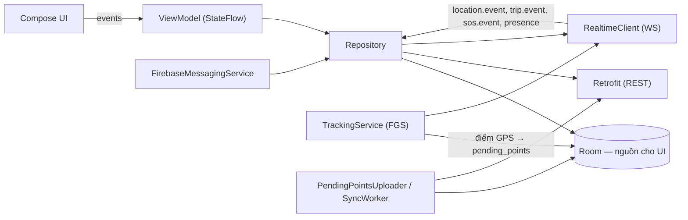

# 12 — Kiến trúc Android

Tham chiếu: ADR-013 (vị trí/nền/OEM), ADR-014 (bản đồ), ADR-018 (kiến trúc), ADR-019 (offline), `07` (WS), `11` §7 (sync). Phiên bản thư viện Android `[CHƯA XÁC MINH: U11]` — pin khi bắt đầu M1; chỉ `targetSdk=36` `[ĐÃ XÁC MINH: S1]` và MapLibre `13.6.1` `[ĐÃ XÁC MINH: S4]` là đã kiểm.

## 1. Thông số nền tảng

| Hạng mục | Giá trị | Nhãn |
|---|---|---|
| `targetSdk` | 36 | `[ĐÃ XÁC MINH: S1]` |
| `compileSdk` | ≥ 36 | suy ra |
| `minSdk` | 26 (Android 8.0) | `[GIẢ ĐỊNH]`, `[CẦN XÁC NHẬN]` (U6: chưa có số liệu phân bố tại VN). Lý do chọn: thông báo kênh (channel) sẵn có, bỏ phần lớn nhánh tương thích cũ, vẫn phủ máy cũ; hạ xuống 24 nếu số liệu cho thấy cần |
| Ngôn ngữ UI | Tiếng Việt (chuỗi trong `strings.xml`, sẵn sàng thêm `en`) | |
| Khai báo manifest | `ACCESS_FINE_LOCATION`, `ACCESS_COARSE_LOCATION`, `FOREGROUND_SERVICE`, `FOREGROUND_SERVICE_LOCATION`, `POST_NOTIFICATIONS` (Android 13+), `INTERNET`, `ACCESS_NETWORK_STATE`, `WAKE_LOCK` (nếu cần), **`ACCESS_BACKGROUND_LOCATION`** (D-04) | S2, ADR-013 |

## 2. Cấu trúc package (single module `:app`)

```
com.motolink
 ├─ app/            Application, DI wiring, navigation, theme
 ├─ core/
 │   ├─ db/         Room: entities, DAO, migrations
 │   ├─ net/        Retrofit services, OkHttp (auth interceptor, refresh authenticator, Idempotency-Key)
 │   ├─ ws/         RealtimeClient (OkHttp WebSocket), codec, reconnect, resume, message router
 │   ├─ location/   LocationSource (Fused | Manager), AdaptiveSampler, Quality filters
 │   ├─ sync/       OutboxOps, SyncWorker (WorkManager), PendingPointsUploader
 │   ├─ push/       FirebaseMessagingService, notification channels
 │   └─ common/     Result, clock, logging (không log tọa độ)
 ├─ feature/
 │   ├─ auth/       login, register, consent, session
 │   ├─ trip/       list, create, join, members, invite
 │   ├─ map/        TripMapScreen, MapViewModel, marker layer
 │   ├─ tracking/   TrackingService (FGS), TrackingController, controls
 │   ├─ history/    sessions list, route view, stats
 │   ├─ sos/        send/receive UI, status, pending queue
 │   └─ settings/   privacy (sharing, consent, export/delete), permissions help, OEM guide
```
Chia theo tính năng + một `core` nhỏ; không tạo module Gradle riêng và không tách domain/data/ui thành ba lớp trừ khi có lý do (ADR-018). Phụ thuộc: `feature → core`, không `feature → feature` trừ qua navigation.

## 3. Lớp dữ liệu và luồng trạng thái



- UI chỉ **quan sát Room** (Flow→StateFlow); mọi dữ liệu từ mạng đi qua Repository rồi ghi Room. Không cập nhật UI trực tiếp từ socket.
- `RealtimeClient` là singleton ở scope ứng dụng, **ref-count** theo "có UI trip đang hiển thị" hoặc "đang tracking"; không giữ WS khi cả hai đều false (tiết kiệm pin; SOS khi đó đến bằng FCM).
- Mapper giao thức ↔ domain ở `core/ws`; message lạ bị bỏ qua nhưng cursor vẫn tiến (`07` §3.5).

### Room schema (chính)
| Bảng | Khóa | Mục đích |
|---|---|---|
| `me` | id | Hồ sơ, consent hiện hành |
| `trip` | trip_id | Cache trip |
| `member` | (trip_id, user_id) | Thành viên + `sharing_state`, màu, presence |
| `member_location` | (trip_id, user_id) | Điểm cuối `(session_id, seq, lat, lng, …, server_ts)` — áp dụng có điều kiện |
| `trip_cursor` | trip_id | `last_event_seq` |
| `event_log` | (trip_id, event_seq) | Event bền gần đây (hiển thị thông báo/lịch sử) |
| `local_session` | session_id | Session của mình: trạng thái, `next_seq`, `started_at` |
| `pending_point` | (session_id, seq) | Điểm chưa được ACK (cũng là lịch sử cục bộ tạm) |
| `pending_sos` | client_sos_id | SOS chưa ACK + trạng thái hiển thị |
| `outbox_op` | op_id | Thao tác REST chờ đồng bộ |
| `route_cache` | session_id | Tuyến đã tải để xem lại |

## 4. Nguồn vị trí

### 4.1 Hai triển khai sau một interface
- `FusedLocationSource`: khi Google Play Services khả dụng (kiểm tra lúc chạy). Yêu cầu theo `LocationRequest` với ưu tiên/khoảng thời gian do `AdaptiveSampler` điều khiển.
- `PlatformLocationSource` (`LocationManager`, `GPS_PROVIDER` + `NETWORK_PROVIDER` làm dự phòng): dùng khi không có GMS (một số máy Huawei/ROM không GMS). Chất lượng pin/độ chính xác kém hơn; phải tự lọc nhiễu. `devices.has_gms` báo lên server để biết FCM không dùng được.
- Quyết định đặt sau interface vì thay đổi cần ít code (ADR-013).

### 4.2 Lấy mẫu thích ứng (khởi điểm — hiệu chỉnh ở M1 bằng thực nghiệm)
| Trạng thái (suy ra từ tốc độ làm mượt) | Khoảng thời gian | Khoảng cách tối thiểu | Ưu tiên |
|---|---|---|---|
| Chạy (> 2 m/s) | 3 s (2–5 s) | 5 m | cao (high accuracy) |
| Chậm (0.5–2 m/s) | 5 s | 5 m | cao |
| Đứng yên (< 0.5 m/s trong ≥ 20 s) | 20 s (15–30 s) | — | cân bằng |
| Đứng yên dài (≥ 2 phút) | 30 s | — | cân bằng |
Mọi điểm: bỏ nếu `accuracy > 50 m` (ngưỡng client; server nhận tới 200 m) — hiển thị "tín hiệu yếu". Mỗi điểm đạt chuẩn được gán `seq` tăng dần **trước** khi ghi `pending_point` (một transaction Room cập nhật `local_session.next_seq`) để `seq` không bị cấp trùng sau khi process chết.

## 5. Quyền và Foreground Service

### 5.1 Luồng xin quyền (Android 10/11+/12+/13+)
1. **Consent riêng** (màn hình disclosure, `11` §5.1) → người dùng đồng ý.
2. Xin `ACCESS_FINE_LOCATION` (+ coarse) "khi dùng ứng dụng" (ngữ cảnh: bấm *Bắt đầu*). Android 12+: nếu người dùng chọn chỉ *Xấp xỉ* ⇒ cho phép nhưng cảnh báo "Vị trí sẽ kém chính xác" `[ĐÃ XÁC MINH: S3]`.
3. Android 13+: xin `POST_NOTIFICATIONS` để thấy thông báo FGS (không từ chối thì tracking vẫn chạy nhưng thông báo bị ẩn khỏi người dùng — vẫn hiện trong Task Manager FGS; nhắc người dùng bật).
4. Khởi động `TrackingService` khi người dùng bấm *Bắt đầu* (app ở foreground) bằng `startForegroundService` + `startForeground(type=location)`. FGS `location` chỉ khởi tạo được từ nền khi đã có quyền nền `[ĐÃ XÁC MINH: S2]` ⇒ có quyền nền thì tự phục hồi sau khi bị kill là khả thi về mặt API (kiểm ở M1), không có thì mọi lần khởi tạo phải từ tương tác người dùng.
5. Đề nghị "Bỏ qua tối ưu pin" qua `ACTION_REQUEST_IGNORE_BATTERY_OPTIMIZATIONS` **chỉ khi** người dùng đã thấy hiện tượng mất nền hoặc qua mục hướng dẫn trong Cài đặt (Google Play có chính sách riêng về quyền này `[CHƯA XÁC MINH]` ⇒ ưu tiên dẫn tới trang cài đặt pin thay vì quyền `REQUEST_IGNORE_BATTERY_OPTIMIZATIONS` trong manifest).
6. **Xin quyền nền** (D-04, ADR-013) sau khi đã có quyền foreground, *chỉ trong ngữ cảnh người dùng đang bật tracking*: màn hình giải thích (cho biết thu cả khi màn hình tắt) → mở trang Settings đúng với nhãn từ `getBackgroundPermissionOptionLabel()` → xử lý từ chối (app vẫn dùng được, tracking chạy khi app/FGS còn sống) `[ĐÃ XÁC MINH: S3]`. Nếu người dùng chỉ cấp vị trí xấp xỉ thì quyền nền cũng chỉ xấp xỉ.

### 5.2 Ba trạng thái xử lý vị trí

| Trạng thái app | Điều gì chạy | Ghi chú |
|---|---|---|
| **Foreground** (UI mở, có thể đang tracking) | UI + `RealtimeClient` + (nếu tracking) service | Đầy đủ |
| **Background nhưng FGS còn sống** (tắt màn hình, app ẩn) | `TrackingService` (FGS `location`) giữ GPS + gửi điểm qua WS (kết nối do service giữ); UI không chạy | Đây là chế độ chính khi đi xe; wakelock chỉ phần CPU gửi/ghi (partial), không giữ khi không cần |
| **Process bị thu hồi / FGS bị kill** | Không có gì chạy | Xem §5.3 |

### 5.3 Các hãng kill service nền — cái gì sửa được, cái gì không
Chi tiết hành vi theo ROM `[CHƯA XÁC MINH: U13]` — **kết quả M1 trên máy thật là nguồn sự thật**.

**Khắc phục được (giảm xác suất, không loại bỏ):**
- Dùng đúng FGS `location` + thông báo liên tục có ích, không bị nhóm "tạm" bị hệ thống dọn trước.
- Hướng dẫn người dùng (màn hình theo hãng/ROM): bật "Tự khởi động"/"Autostart", đặt pin của app là "Không giới hạn"/"Không tối ưu", khóa app trong màn hình Recents (Xiaomi/Oppo/Vivo/Samsung có tên mục khác nhau). Tin cậy vào ảnh chụp màn hình thực tế từ máy test.
- Ghi điểm vào Room liên tục ⇒ **không mất điểm đã ghi** khi bị kill.
- Phát hiện gián đoạn: khi mở lại app, nếu `local_session.status='active'` nhưng service không chạy ⇒ hiển thị "Chuyến ghi bị gián đoạn lúc HH:MM", đánh dấu khoảng trống, đề nghị tiếp tục (session cũ hoặc mới).
- Server phát hiện `timeout` (không điểm > 10 phút `[GIẢ ĐỊNH]`): gửi thông báo FCM "Việc ghi vị trí của bạn bị gián đoạn — chạm để tiếp tục" (loại `tracking_interrupted`, chỉ máy có GMS) và báo cho người xem bằng presence `offline` + vị trí "cũ".
- `START_STICKY` + khôi phục từ Room: có thể giúp trên một số ROM, **không** đáng tin; có quyền nền thì việc khởi chạy lại FGS location từ nền được phép về API `[ĐÃ XÁC MINH: S2]` nhưng ROM vẫn có thể chặn khởi động nền — kiểm chứng ở M1 và **không dựa hẳn** vào hành vi này.

**Không khắc phục được chỉ bằng retry / WorkManager:**
- Một số ROM kill process và chặn mọi khởi động nền (kể cả FGS) khi người dùng vuốt app khỏi Recents hoặc tiết kiệm pin: không có API công khai để chống lại. `WorkManager` không thể thu GPS liên tục (chỉ chạy ngắt quãng, không phải real-time), và cũng bị hạn chế bởi cùng chính sách.
- Máy không GMS: không có FCM ⇒ không có đường đẩy khi app không chạy (SOS chỉ đến khi app mở).
- Người dùng tắt định vị/GPS hệ thống hoặc thu hồi quyền: chỉ phát hiện và báo (`LocationAvailability`/lỗi), không thể bật hộ.

**Thông điệp với người dùng:** trong onboarding và README: "MotoLink chỉ ghi vị trí khi bạn bấm Bắt đầu và hệ điều hành cho phép; một số điện thoại cần cài đặt thêm để không bị tắt ngầm."

## 6. Thông báo
| Kênh | Mức | Dùng cho |
|---|---|---|
| `tracking` | Low (không âm) | FGS: "Đang ghi hành trình" + nút Tạm dừng / Kết thúc |
| `sos` | High (âm, rung, bỏ qua im lặng nếu được phép) | SOS |
| `trip` | Default | Thành viên mới, bắt đầu/kết thúc trip |
| `system` | Low | Gián đoạn tracking, cần cập nhật |
Nhận FCM: `onMessageReceived` (data message) ⇒ gọi `GET /sos/{id}` (REST) hiển thị đầy đủ ⇒ `POST /sos/{id}/receipt received`. Nếu không lấy được chi tiết (mất mạng) vẫn hiện thông báo tối thiểu từ payload (không có tọa độ). Dedupe theo `ref_event_id` (Room).

## 7. Bản đồ (ADR-014)

- `org.maplibre.gl:android-sdk` **13.6.1** `[ĐÃ XÁC MINH: S4]` bọc trong `AndroidView` (Compose); vòng đời `MapView` gắn `LifecycleOwner`.
- Style URL lấy từ `GET /v1/config` (`tile_style_url`) ⇒ đổi nguồn tile không cần phát hành app. Không hard-code URL OSM công cộng.
- Marker: một `GeoJsonSource` + `SymbolLayer`/`CircleLayer` cho thành viên; cập nhật tối đa 1 Hz (gộp), nội suy mượt vị trí giữa hai điểm (animation 1–2 s). Marker "cũ" (tuổi > 30 s) mờ đi, > 90 s hiển thị biểu tượng cảnh báo "mất tín hiệu"; tuổi tính từ `server_ts` hiệu chỉnh bằng `clock_offset_ms`.
- Vẽ tuyến lịch sử bằng `LineLayer` từ polyline đã đơn giản hóa (server) hoặc từ `pending_point` cục bộ cho session đang chạy.
- Camera: chế độ "theo tôi"/"xem cả nhóm" (fit bounds); tắt tự theo khi người dùng kéo.
- Attribution hiển thị đúng yêu cầu nguồn dữ liệu/tile (ADR-014); kiểm tra hiển thị Hoàng Sa/Trường Sa là tiêu chí nghiệm thu (U4).
- Offline map: ngoài MVP.

## 8. Mạng
- Retrofit + OkHttp: `AuthInterceptor` (Bearer), `Authenticator` (refresh có khóa đơn — chỉ một refresh tại một thời điểm), `IdempotencyInterceptor` (đọc `op_id` từ tag của request), timeout 15 s, `Cache` tắt cho API động.
- WebSocket: OkHttp `WebSocket`; `pingInterval` 25 s; reconnect backoff 1→30 s jitter (`07` §4); chạy trong scope ứng dụng; callback → kênh nội bộ có giới hạn ⇒ coroutine xử lý tuần tự (giữ thứ tự), không chặn thread OkHttp.
- Chỉ HTTPS/WSS ở release.

## 9. Tiêu hao pin và đo đạc (kế hoạch, không phải số liệu)
Mục tiêu đo ở M1/M7 (xem `14`): % pin/giờ khi tracking với màn hình tắt trên ≥ 3 máy (Xiaomi/Oppo, Samsung, một máy tầm thấp), so sánh hồ sơ lấy mẫu; độ chính xác (so với tuyến đã biết); số lần mất nền. Ngưỡng chấp nhận chốt sau M1 `[CẦN XÁC NHẬN]`.
