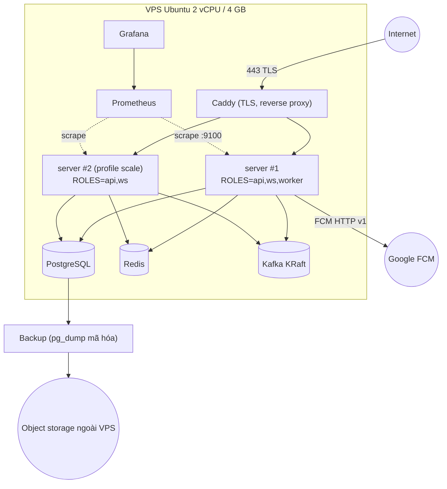

# 13 — Triển khai, quan sát, capacity estimation

Tham chiếu: ADR-001, ADR-007, ADR-010, ADR-017. Phiên bản image `[CẦN XÁC NHẬN]` (U10) — dưới đây dùng placeholder `<tag>`; **pin digest** khi code. Mọi con số capacity là **tính toán từ giả định** (`[GIẢ ĐỊNH]`), kèm kế hoạch đo ở `14`.

> **Cập nhật 2026-10-10 (D-09):** chủ dự án chọn dùng backend miễn phí thay vì thuê VPS. Tài liệu này vẫn mô tả mục tiêu cho **một host Linux 2 vCPU/4 GB**; chưa có nhà cung cấp free-tier nào được chọn hoặc tra cứu `[CHƯA XÁC MINH]`, và khả năng chạy Kafka + 2 instance trên đó là rủi ro R-21 (`16`). Ngân sách RAM §4.3 là điều kiện tối thiểu để kiến trúc hiện tại chạy được; nếu host nhỏ hơn thì dùng `HISTORY_SINK=direct_pg` hoặc đổi kiến trúc triển khai.

## 1. Topology



Mạng Docker nội bộ duy nhất; chỉ `caddy` publish 80/443. Cổng metrics `9100` và health chỉ trong mạng nội bộ.

## 2. Docker Compose (phác thảo, nằm trong tài liệu — chưa phải file thật)

```yaml
# docker-compose.yml (phác thảo)
services:
  caddy:
    image: caddy:<tag>
    ports: ["80:80", "443:443"]
    volumes: ["./Caddyfile:/etc/caddy/Caddyfile:ro", "caddy_data:/data"]
    depends_on: [server]
    mem_limit: 64m

  server:                      # ROLES=api,ws,worker
    image: motolink/server:<tag>
    env_file: .env
    environment: { ROLES: "api,ws,worker", GOMEMLIMIT: "200MiB" }
    depends_on:
      migrate: { condition: service_completed_successfully }
      postgres: { condition: service_healthy }
      redis:    { condition: service_healthy }
      kafka:    { condition: service_healthy }
    healthcheck: { test: ["CMD", "/app/server", "healthcheck"], interval: 10s }
    stop_grace_period: 30s
    restart: unless-stopped
    mem_limit: 256m

  server2:                     # profile scale: kiểm thử multi-instance
    profiles: ["scale"]
    image: motolink/server:<tag>
    env_file: .env
    environment: { ROLES: "api,ws", GOMEMLIMIT: "200MiB" }
    stop_grace_period: 30s
    mem_limit: 256m

  migrate:
    image: motolink/server:<tag>
    command: ["/app/server", "migrate", "up"]
    env_file: .env
    depends_on: { postgres: { condition: service_healthy } }
    restart: "no"

  postgres:
    image: postgres:<major>    # không PostGIS ở MVP (ADR-010)
    environment: { POSTGRES_DB: motolink, POSTGRES_USER: motolink, POSTGRES_PASSWORD_FILE: /run/secrets/pg_password }
    command: ["postgres", "-c", "shared_buffers=512MB", "-c", "max_connections=50",
              "-c", "work_mem=8MB", "-c", "synchronous_commit=on"]
    volumes: ["pg_data:/var/lib/postgresql/data"]
    healthcheck: { test: ["CMD-SHELL", "pg_isready -U motolink"], interval: 5s }
    mem_limit: 1100m

  redis:
    image: redis:<tag>
    command: ["redis-server", "--maxmemory", "128mb", "--maxmemory-policy", "volatile-ttl",
              "--save", "", "--appendonly", "no", "--requirepass", "${REDIS_PASSWORD}"]
    healthcheck: { test: ["CMD", "redis-cli", "-a", "${REDIS_PASSWORD}", "ping"], interval: 5s }
    mem_limit: 160m

  kafka:
    image: apache/kafka:<tag>  # 4.3.1 là tag không-rc mới nhất thấy ngày 2026-10-10 (S5); pin khi code
    environment:
      KAFKA_NODE_ID: 1
      KAFKA_PROCESS_ROLES: "broker,controller"
      KAFKA_LISTENERS: "PLAINTEXT://:9092,CONTROLLER://:9093"
      KAFKA_ADVERTISED_LISTENERS: "PLAINTEXT://kafka:9092"
      KAFKA_CONTROLLER_QUORUM_VOTERS: "1@kafka:9093"
      KAFKA_CONTROLLER_LISTENER_NAMES: "CONTROLLER"
      KAFKA_OFFSETS_TOPIC_REPLICATION_FACTOR: 1
      KAFKA_TRANSACTION_STATE_LOG_REPLICATION_FACTOR: 1
      KAFKA_TRANSACTION_STATE_LOG_MIN_ISR: 1
      KAFKA_AUTO_CREATE_TOPICS_ENABLE: "false"
      KAFKA_NUM_PARTITIONS: 3
      KAFKA_HEAP_OPTS: "-Xms384m -Xmx512m"
    volumes: ["kafka_data:/var/lib/kafka/data"]
    mem_limit: 900m

  kafka-init:                  # tạo topic theo 09-kafka.md
    image: apache/kafka:<tag>
    depends_on: { kafka: { condition: service_healthy } }
    restart: "no"

  prometheus: { image: prom/prometheus:<tag>, mem_limit: 256m, profiles: ["obs"] }
  grafana:    { image: grafana/grafana:<tag>,  mem_limit: 192m, profiles: ["obs"] }
volumes: { pg_data: {}, kafka_data: {}, caddy_data: {} }
```
Ghi chú: biến môi trường Kafka dạng `KAFKA_*` của image chính thức `[CHƯA XÁC MINH]` về tên chính xác — kiểm tra theo tài liệu image khi dựng. `mem_limit` là ngân sách, không phải đo đạc.

`Caddyfile` (phác thảo):
```
api.motolink.example {
    encode zstd gzip
    reverse_proxy server:8080 server2:8080 {
        lb_policy least_conn
        health_uri /readyz
        health_interval 5s
        flush_interval -1          # WS/stream: không đệm
    }
}
```
Tên miền và DNS: `[GIẢ ĐỊNH]` đã có; Caddy lấy chứng chỉ tự động. WS qua Caddy không cần cấu hình đặc biệt ngoài `flush_interval` (xác minh khi dựng). Header `X-Forwarded-For` tin cậy chỉ từ Caddy.

### 2.1 Biến môi trường chính (`.env.example`)
`APP_ENV`, `ROLES`, `HTTP_ADDR`, `METRICS_ADDR`, `DATABASE_URL`, `REDIS_ADDR`, `REDIS_PASSWORD`, `KAFKA_BROKERS`, `HISTORY_SINK` (`kafka|direct_pg`), `JWT_ED25519_PRIVATE_KEY_FILE`, `JWT_KID`, `FCM_CREDENTIALS_FILE`, `WS_MAX_CONNS`, `WS_MAX_CONNS_PER_IP`, `INSTANCE_ID` (mặc định sinh ngẫu nhiên), `LOG_LEVEL`, `DEBUG_LOG_COORDS` (cấm ở prod), `RETENTION_FULLRES_DAYS` (30), `RETENTION_PARTITION_DAYS` (90), `ARGON2_MAX_CONCURRENCY` (2).

### 2.2 Migration, health, shutdown
- `migrate up` chạy một lần trước khi `server` khởi động (goose, SQL embed). Migration tương thích ngược một bản (expand/contract) để chạy 2 phiên bản cùng lúc khi rolling restart.
- `/healthz` (process sống), `/readyz` (PG ping, Redis ping, đã `Start` xong hub; Kafka lỗi chỉ cảnh báo, không làm unready vì live vẫn chạy).
- Shutdown graceful: `10` §7. `stop_grace_period: 30s`.
- Deploy: `docker compose pull && docker compose up -d` từng instance một (`server` rồi `server2`) ⇒ client reconnect (`closing` + backoff jitter).

## 3. Backup / restore PostgreSQL

| Mục | Quyết định |
|---|---|
| Phương pháp MVP | `pg_dump -Fc` hằng đêm (`cron` trên host chạy `docker exec`), mã hóa bằng `age`, đẩy ra object storage ngoài VPS (`rclone`; nhà cung cấp `[CẦN XÁC NHẬN]`) |
| RPO / RTO | RPO ≤ 24 giờ; RTO ≤ 2 giờ `[GIẢ ĐỊNH]` |
| Giữ | 7 bản ngày + 4 bản tuần |
| Nâng cấp sau | WAL archiving + `pg_basebackup` (PITR) khi RPO 24 giờ không chấp nhận được |
| Không backup | Redis (tạm), Kafka (đệm; PG là sự thật) |
| Kiểm thử | Mỗi tháng restore vào DB tạm và chạy truy vấn kiểm tra (đếm trip/session, điểm mẫu); lập lịch ở M7 |

Restore: dừng `server`; tạo DB mới; `pg_restore --clean --if-exists -d`; chạy `migrate up`; khởi động; client tự resync. Các điểm GPS đã ACK nhưng chưa vào PG nằm trong Kafka (≤ 3 ngày) sẽ được `history-writer` ghi lại khi consumer chạy lại **nếu** offset group được reset về thời điểm backup (thao tác vận hành, idempotent).

## 4. Capacity estimation

### 4.1 Giả định
| Biến | Giá trị |
|---|---|
| Thiết bị đồng thời | 500 (benchmark mở rộng); MVP thực tế ≈ 50 trip × ≤ 10 |
| Chu kỳ gửi | 3 s khi chạy (đỉnh), nên **167 điểm/s** vào (500/3) |
| Fan-out | trip 10 người ⇒ ×9 ⇒ **≈ 1 500 lượt giao/s** |
| Giờ tracking đỉnh mỗi ngày | 4 giờ (khoảng đi chơi), để tính tổng ngày |
| Kích thước điểm JSON qua WS | ≈ 270 B (envelope ≈ 120 + điểm ≈ 150) |
| Overhead mạng mỗi frame (WS+TLS+TCP/IP) | ≈ 70–80 B |

### 4.2 Kết quả

| Hạng mục | Tính | Kết quả | Nhận xét |
|---|---|---|---|
| Băng thông vào | 167/s × (270+75) B | ≈ 58 KB/s ≈ **0.5 Mbps** | |
| Băng thông ra (không gộp) | 1 500/s × (270+75) B | ≈ 520 KB/s ≈ **4.1 Mbps** | |
| Băng thông ra (gộp theo 250 ms–1 s, `10` §5) | mỗi client ≈ 3 điểm/s × 170 B + ≈ 100 B envelope + 75 B overhead | ≈ 680 B/s/client ⇒ 500 client ≈ 340 KB/s ≈ **2.7 Mbps** | Coalescing giảm ~35 % |
| Lưu lượng ra mỗi ngày (đỉnh 4 h) | 340 KB/s × 14 400 s | ≈ **4.9 GB/ngày** ⇒ ~147 GB/tháng nếu đỉnh mọi ngày | **Cần kiểm tra hạn mức băng thông VPS** `[CẦN XÁC NHẬN]` |
| Dữ liệu di động mỗi người dùng (xe 1 giờ, nhóm 10) | ≈ 680 B/s xuống + ≈ 345 B/3 s lên ≈ 0.8 KB/s | ≈ **3 MB/giờ** (chưa tính TLS handshake, ping) | Chấp nhận được |
| Redis RAM | 500 hash × ~300 B + 50 zset nhỏ | **< 1 MB**; baseline Redis vài MB | `maxmemory 128mb` dư rất nhiều |
| Redis ops/s | 167 Lua + 167 PUBLISH + 25 presence ≈ 360/s | nhẹ | |
| Kafka ghi | 167 rec/s × ~100 B (nén zstd, `[GIẢ ĐỊNH]` 280 B → ~100 B) | ≈ **17 KB/s** | |
| Kafka đĩa (retention 3 ngày) | 17 KB/s × 14 400 s × 3 | ≈ **0.75 GB** (đỉnh 4 h/ngày) hoặc ≈ **4.3 GB** nếu đỉnh 24 h/ngày | Giới hạn `retention.bytes` 2 GiB/partition |
| PG hàng/ngày | 167 × 14 400 | **2.4 M hàng** | |
| PG kích thước/ngày | 2.4 M × ~150 B (heap + PK index) | ≈ **360 MB/ngày** (đỉnh 24 h: ≈ 2.2 GB) | |
| PG 30 ngày thô | 360 MB × 30 | ≈ **11 GB** | + WAL, + bloat 20–30 % ⇒ ~14 GB. Điều chỉnh `RETENTION_FULLRES_DAYS` theo đĩa |
| PG ghi | 167 hàng/s, lô 500/200 ms | rất nhẹ cho 2 vCPU | Kỳ vọng I/O không phải nút thắt |
| CPU Go | fan-out 1 500 lượt/s JSON encode (đã gộp ⇒ ~500 frame/s) | ≲ 0.3 core `[GIẢ ĐỊNH]` | Cần đo ở M3/M4 |
| CPU TLS (Caddy) | ≈ 500 frame/s ra + 167 vào | ≲ 0.2 core | |
| Argon2id | bộ nhớ lớn mỗi lần băm (ví dụ 64 MiB × song song) | **giới hạn đồng thời = 2** (`ARGON2_MAX_CONCURRENCY`) để không vỡ RAM khi nhiều người đăng nhập cùng lúc | |
| Goroutine/bộ nhớ Go | ~1 025 goroutine, 20–40 KiB/kết nối | 10–20 MiB + heap nền | Đặt `GOMEMLIMIT` |

### 4.3 Ngân sách RAM 4 GB (cả Kafka)

| Thành phần | Ngân sách (MiB) | Ghi chú |
|---|---|---|
| OS + Docker daemon | 400 | |
| Caddy | 50 | |
| Go server ×2 | 2 × 200 | `GOMEMLIMIT=200MiB`, `mem_limit 256m` |
| PostgreSQL | 900 | `shared_buffers=512MB` + backend (≤ 50) + work_mem |
| Redis | 80 | thực tế < 20 |
| Kafka (JVM) | 700 | heap 512 + metaspace/off-heap; page cache dùng chung với OS |
| Prometheus | 200 | retention 7 ngày, scrape 15 s |
| Grafana | 120 | tắt khi cần RAM (`profile obs`) |
| **Tổng cam kết** | **≈ 2 850 MiB** | Còn ≈ 1.1 GiB cho page cache/đột biến |
Kết luận: **vừa với 4 GB nhưng không thoải mái.** Kafka là thành phần tốn nhất ngoài PG; nếu thiếu RAM: tắt Grafana (xem số liệu từ xa), giảm heap Kafka tới 384 MiB (đo), hoặc chuyển `HISTORY_SINK=direct_pg` (ADR-007) tiết kiệm ≈ 700 MiB. Số liệu **phải được đo** ở M5/M7.

### 4.4 Kiểm chứng giả định của prompt
Con số "167 update/s, fan-out 9× ≈ 1 500/s" **đúng số học** và là kịch bản xấu nhất (mọi thiết bị đang chạy xe cùng lúc). Nút thắt thật không phải CPU/RAM mà là **băng thông ra hàng tháng** và **dung lượng đĩa PG** (xem bảng). Với 50 trip đồng thời, đỉnh thực tế có thể thấp hơn nhiều vì thiết bị đứng yên gửi 15–30 s/lần (giảm 5–10× điểm đứng yên).

## 5. Observability

### 5.1 Logging
`slog` JSON ra stdout; trường chuẩn: `ts, level, msg, request_id, user_id (nếu có), trip_id, conn_id, instance_id, module`. **Không** có tọa độ (`11` §4.5). Xoay vòng log bằng driver Docker (`json-file` với `max-size`, `max-file`).

### 5.2 Metrics (Prometheus, cổng nội bộ)

**Metrics phản ánh chất lượng sản phẩm** (quyết định chúng ta có đang phục vụ tốt không):

| Metric | Loại | Cách đo |
|---|---|---|
| `product_location_age_seconds` | histogram | **Tuổi vị trí hiển thị cho người xem**: client gửi mẫu ẩn danh (`POST /v1/telemetry/client`, không tọa độ, chỉ histogram bucket) = `now_corrected − server_ts` lúc hiển thị; server phía cũng đo `now − recorded_at` lúc giao (xấp xỉ) |
| `product_location_gap_ratio` | gauge | Tỉ lệ thời gian tracking có khoảng trống > 30 s (tính khi session kết thúc) |
| `product_sos_delivery_ratio` | gauge | Tỉ lệ recipient có `received_at` ≤ 60 s sau `created_at` (job tính từ PG) |
| `product_sos_ack_latency_seconds` | histogram | `created_at` → `received_at` |
| `product_tracking_interrupted_total` | counter | Session kết thúc với `end_reason='timeout'` |
| `product_history_durable_latency_seconds` | histogram | Từ `received_at` đến `COMMIT` PG của điểm đó |

**Metrics để debug/vận hành:**

| Nhóm | Metric |
|---|---|
| WS | `ws_connections` (gauge), `ws_connect_total{result}`, `ws_close_total{code}`, `ws_msgs_in_total{type}`, `ws_msgs_out_total{type}`, `ws_slow_consumer_closes_total`, `ws_outbox_ctrl_depth`, `ws_location_coalesced_total`, `ws_location_dropped_total{reason}` |
| GPS | `gps_points_total{result=accepted|stale|rejected|suspect}`, `gps_update_rate` (rate của counter), `ingest_queue_depth{k}`, `ingest_process_seconds` |
| Fan-out | `fanout_latency_seconds` (từ `received` đến bytes ghi vào socket người nhận), `hub_shard_cmd_depth{shard}`, `pubsub_publish_errors_total`, `pubsub_reconnects_total` |
| Redis | `redis_cmd_duration_seconds{cmd}`, `redis_circuit_state` |
| Kafka | `kafka_produce_duration_seconds`, `kafka_produce_errors_total{reason}`, `kafka_buffered_records`, `kafka_consumer_lag{group,topic,partition}`, `kafka_consumer_lag_seconds`, `kafka_dlq_records_total{topic}` |
| PG | `pg_write_duration_seconds{op}`, `pg_pool_in_use`, `history_batch_size`, `history_rows_inserted_total`, `history_rows_conflicted_total` (trùng bị bỏ — đo mức gửi lại) |
| Process | `go_goroutines`, `go_memstats_*`, `process_cpu_seconds_total`, `goroutine_panics_total{name}` |
| Outbox | `outbox_pending` (gauge), `outbox_publish_lag_seconds` |
| Push | `fcm_send_total{result}`, `fcm_latency_seconds` |

Cardinality: không đặt `user_id`/`trip_id` làm label.

### 5.3 Cảnh báo (ngưỡng khởi điểm `[GIẢ ĐỊNH]`)
`readyz` fail > 1 phút; `kafka_consumer_lag_seconds{group=history-writer}` > 30 s trong 2 phút; `kafka_dlq_records_total` tăng; `outbox_publish_lag_seconds` > 10 s; `ws_slow_consumer_closes_total` rate cao bất thường; `redis_circuit_state` mở > 2 phút; `product_sos_delivery_ratio` < 0.9 (cửa sổ 1 giờ); đĩa > 80 %; RAM host > 90 %; chứng chỉ sắp hết hạn.

### 5.4 Tracing
Hoãn (ADR-002/017): thêm `request_id` + `conn_id` vào log là đủ. Nếu thêm sau: OTel, chỉ cho REST và consumer, không theo từng điểm GPS.

## 6. Thứ tự dựng môi trường dev
1. `docker compose up postgres redis kafka kafka-init` (hạ tầng).
2. Chạy `server` bằng `go run` trên host (hot reload), trỏ tới hạ tầng.
3. Profile `scale`: chạy 2 instance thật bằng Compose để kiểm tra Pub/Sub liên instance.
4. Profile `obs`: Prometheus + Grafana với dashboard mẫu.
