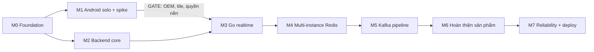

# 15 — Roadmap, task card, Definition of Done

Tham chiếu: prompt mục 10; ADR; contract `05`–`09`. Một developer, vừa làm vừa học ⇒ ưu tiên **bản dùng được** cuối mỗi milestone và kiểm tra rủi ro lớn nhất trước.

## 1. Đánh giá thứ tự đề xuất của prompt

| Điều chỉnh | Lý do |
|---|---|
| Giữ M1 (Android solo + spike nền) đứng **trước** backend | Rủi ro lớn nhất: OEM kill dịch vụ nền. Nếu thất bại phải đổi quyết định (xin quyền nền, đổi cách tiếp cận) trước khi xây hạ tầng |
| Thêm **cổng quyết định (gate) sau M1** | Kết quả máy thật quyết định ADR-013 (có xin `ACCESS_BACKGROUND_LOCATION` không) và ADR-014 (nguồn tile) |
| M0 chỉ làm contract + scaffold tối thiểu; **M1 song song M0-T05/T06** | Contract-first nhưng không để M1 chờ |
| M3 làm Hub với bộ nhớ trước, M4 mới thêm Redis | Dễ test concurrency thuần Go trước khi thêm I/O |
| Chuyển REST `points` + ACK vào M5 (cùng Kafka) | Cùng ngữ nghĩa ACK; tránh làm hai lần |
| Tách "đóng gói phát hành Play" thành task M6 | Review chính sách có độ trễ; cần sớm hơn M7 |

## 2. Tổng quan


M1 và M2 có thể song song sau M0 (nếu chỉ một người, làm M1 trước). M3 cần cả M1 (client cơ sở) và M2 (auth/trip).

| Milestone | Bản dùng được cuối giai đoạn |
|---|---|
| M0 | Tài liệu duyệt, repo + dev stack chạy được, CI xanh |
| M1 | App ghi hành trình **một mình** có bản đồ, chạy nền; báo cáo OEM |
| M2 | Có thể đăng ký, tạo/tham gia trip, quản lý thành viên qua app (chưa realtime) |
| M3 | Nhóm thấy nhau realtime trên **một** server (nội bộ/bạn bè thử) |
| M4 | Chạy 2 instance; presence chuẩn; chịu Redis chập chờn |
| M5 | Lịch sử hành trình bền và ACK; phục hồi khi consumer/ server restart |
| M6 | Đủ tính năng MVP: lịch sử, SOS + FCM, thông báo, riêng tư, consent — **beta kín** |
| M7 | Vận hành được: deploy VPS, giám sát, backup, đã load/soak test — **phát hành hạn chế** |

## 3. Chi tiết milestone

### M0 — Foundation
- **Mục tiêu:** chốt contract, dựng khung dự án, dev local chạy được.
- **Dependency:** chủ dự án duyệt `16` (các quyết định `[CẦN XÁC NHẬN]` chặn).
- **Task:** backend M0-T03, M0-T04, M0-T05; android M0-T06; infra M0-T01, M0-T02.
- **Demo:** `docker compose up` dựng PG/Redis/Kafka; `server migrate up`; `/healthz` OK; app Android rỗng chạy trên máy.
- **Test bắt buộc:** CI chạy lint + `go test`; test golden contract rỗng pass; test redaction log.
- **Nghiệm thu:** DoD M0 (§5).

### M1 — Android prototype dùng một mình + spike nền
- **Mục tiêu:** loại bỏ rủi ro nền/OEM/bản đồ **sớm**.
- **Dependency:** M0-T06.
- **Task:** android M1-T01…T08.
- **Demo:** ghi một chuyến 60 phút màn hình tắt, vẽ tuyến, lưu Room, xem lại.
- **Test bắt buộc:** unit `AdaptiveSampler`, `seq` allocation; field test ≥ 60 phút trên ≥ 1 Xiaomi/Oppo + 1 Samsung; kiểm bản đồ Hoàng Sa/Trường Sa; đọc ToS tile.
- **Nghiệm thu:** báo cáo M1 (tỉ lệ mất nền, pin/giờ, độ chính xác, quyết định nguồn tile). **GATE:** nếu mất nền > ngưỡng chấp nhận (chốt cùng chủ dự án, khởi điểm: mất > 1 lần/giờ trên máy được cấu hình đúng) ⇒ họp lại ADR-013 trước M3.

### M2 — Backend core
- **Mục tiêu:** auth, trip lifecycle, membership, PG, REST theo `06`.
- **Dependency:** M0.
- **Task:** backend M2-T01…T09, M2-T11; android M2-T10.
- **Demo:** hai tài khoản tạo/tham gia trip bằng mã qua app; owner xóa thành viên.
- **Test bắt buộc:** unit máy trạng thái; integration T1–T7 (testcontainers PG); ma trận authz; idempotency; refresh reuse.
- **Nghiệm thu:** DoD M2.

### M3 — Go realtime
- **Mục tiêu:** WS, Hub, heartbeat, backpressure, reconnect, snapshot (bộ nhớ, một instance).
- **Dependency:** M1 (client cơ sở), M2.
- **Task:** backend M3-T01…T07, T10; android M3-T08, T09.
- **Demo:** 3 điện thoại thấy nhau chạy; tắt Wi-Fi 30 s rồi bật lại, đồng bộ lại.
- **Test bắt buộc:** `-race`, `goleak`, slow consumer (A5), shutdown (A6), protocol golden, B1 (50 thiết bị).
- **Nghiệm thu:** DoD M3.

### M4 — Multi-instance Redis
- **Mục tiêu:** vị trí hiện tại + TTL, presence, Pub/Sub ≥ 2 instance.
- **Dependency:** M3.
- **Task:** backend M4-T01…T04; infra M4-T05; android M4-T06.
- **Demo:** người A ở instance 1, người B ở instance 2 thấy nhau; kill Redis 60 s rồi hồi phục.
- **Test bắt buộc:** Lua `loc_set` với Redis thật (`14` §3.1); A3; B3; B7 (Redis).
- **Nghiệm thu:** DoD M4.

### M5 — Kafka pipeline
- **Mục tiêu:** nhánh bền, ACK, consumer ghi PG idempotent, outbox, phục hồi.
- **Dependency:** M4.
- **Task:** backend M5-T01…T05, T07…T09; android M5-T06.
- **Demo:** tắt mạng 10 phút giữa chuyến, bật lại ⇒ lịch sử đủ, không trùng; kill consumer ⇒ không trùng.
- **Test bắt buộc:** A7, A8, B6, B7 (Kafka); đo RAM Kafka thực (`13` §4.3).
- **Nghiệm thu:** DoD M5.

### M6 — Hoàn thiện sản phẩm
- **Mục tiêu:** lịch sử/thống kê, SOS + FCM, thông báo, riêng tư, consent, chuẩn bị Play.
- **Dependency:** M5.
- **Task:** backend M6-T01…T03, T05, T06, T09; android M6-T04…T07; docs M6-T08.
- **Demo:** SOS tới máy có app tắt; xem lại tuyến, xóa tài khoản.
- **Test bắt buộc:** E2E SOS (mất mạng, trùng, FCM lỗi → DLQ); retention job; consent flow; không log tọa độ (`14` §3.6).
- **Nghiệm thu:** DoD M6. **Beta kín.**

### M7 — Reliability & performance
- **Mục tiêu:** load/soak/chaos, quan sát, backup, deploy VPS.
- **Dependency:** M6.
- **Task:** infra M7-T02…T04; backend M7-T01, T06; android M7-T05; docs M7-T07.
- **Demo:** dashboard sống; diễn tập restore; sự cố mô phỏng được phát hiện bằng cảnh báo.
- **Test bắt buộc:** B1–B9; test thực địa Android (`14` §5); diễn tập backup.
- **Nghiệm thu:** DoD M7. **Phát hành hạn chế.**

## 4. Task card

Quy ước: **[CHỜ-CONTRACT]** = phải đợi contract tương ứng được duyệt (`16` quyết định đã xác nhận) · **Song song** = có thể làm cùng lúc nếu có hai người/ hai luồng; một developer thì chọn theo thứ tự. "Output" là package/file dự kiến, không phải tên hàm. Lệnh test là đề xuất; lệnh Gradle `[CẦN XÁC NHẬN]` khi có project.

### M0

```
ID:            M0-T01
Tiêu đề:       Khởi tạo monorepo, go.mod, CI lint+test
Loại:          infra
Phụ thuộc:     (duyệt 16)
Song song với: M0-T05
Input:         04-modules.md §1, ADR-002
Output:        server/ (go.mod, cmd/server), deploy/, .github/workflows (hoặc CI tương đương), .golangci cấu hình, Makefile
Acceptance:    CI xanh trên nhánh trống; go vet + lint + test chạy; không có code nghiệp vụ
Lệnh test:     go build ./... && go test ./... -race
Kích thước:    S
Checklist review: phiên bản Go được ghim; không dependency thừa; có govulncheck
```
```
ID:            M0-T02
Tiêu đề:       Dev stack Docker Compose (PG, Redis, Kafka KRaft, init topic)
Loại:          infra
Phụ thuộc:     M0-T01
Song song với: M0-T03
Input:         13 §2, 09 §2, ADR-007
Output:        deploy/docker-compose.yml, deploy/.env.example, deploy/kafka-init/
Acceptance:    `docker compose up` lên healthy; 3 topic + DLQ tồn tại đúng cấu hình; tag image pin theo digest; RAM thực đo ghi vào PROGRESS
Lệnh test:     docker compose up -d && docker compose ps && script kiểm topic
Kích thước:    M
Checklist review: không publish cổng PG/Redis/Kafka ra host công khai; mật khẩu từ .env; mem_limit đặt
```
```
ID:            M0-T03
Tiêu đề:       Config, logger (redaction tọa độ), metrics skeleton, ID UUIDv7
Loại:          backend
Phụ thuộc:     M0-T01
Song song với: M0-T02, M0-T04
Input:         ADR-016, 11 §4.5, 13 §5.1
Output:        server/internal/platform/{config,log,metrics,id,clock}
Acceptance:    test chứng minh log không chứa field lat/lng/coords; metrics endpoint trả; UUIDv7 sắp xếp theo thời gian
Lệnh test:     go test ./internal/platform/... -race
Kích thước:    M
Checklist review: DEBUG_LOG_COORDS bị cấm ở APP_ENV=prod; không label cardinality cao
```
```
ID:            M0-T04
Tiêu đề:       Migration framework + schema nền từ 05
Loại:          backend
Phụ thuộc:     M0-T02, M0-T03  [CHỜ-CONTRACT: 05]
Song song với: M0-T05
Input:         05-data-model.md, ADR-010
Output:        server/db/migrations/*.sql, server/db/queries/ (rỗng/khung), sqlc config, lệnh migrate trong cmd/server
Acceptance:    migrate up/down trên PG trống; mọi bảng 05 tạo đúng; partition location_points tạo tháng hiện tại+2; schema khớp 05 (kiểm bằng test đọc information_schema)
Lệnh test:     go test ./db/... (testcontainers)
Kích thước:    M
Checklist review: CHECK/UNIQUE/FK đúng 05; index đủ; không PostGIS
```
```
ID:            M0-T05
Tiêu đề:       Golden JSON contract tests (WS + REST) dùng chung Go/Android
Loại:          docs
Phụ thuộc:     (duyệt 06, 07)  [CHỜ-CONTRACT: 06, 07]
Song song với: M0-T01, M0-T06
Input:         06, 07
Output:        contract-tests/ws/*.json, contract-tests/rest/*.json, README mô tả cách dùng
Acceptance:    mỗi type trong 07 §2 có ít nhất một mẫu hợp lệ + một mẫu không hợp lệ; mỗi endpoint 06 có mẫu request/response
Lệnh test:     (kiểm bằng test ở M3-T01 và Android M3-T08)
Kích thước:    M
Checklist review: bám đúng tên field; không chứa dữ liệu thật
```
```
ID:            M0-T06
Tiêu đề:       Khung dự án Android (:app), theme, navigation, Room trống
Loại:          android
Phụ thuộc:     M0-T01
Song song với: M0-T05
Input:         12 §1–2, ADR-018
Output:        android/ (Gradle), app/ package theo 12 §2, targetSdk 36, minSdk 26
Acceptance:    build debug + chạy trên máy; manifest KHÔNG có ACCESS_BACKGROUND_LOCATION; lint xanh
Lệnh test:     ./gradlew :app:assembleDebug :app:testDebugUnitTest
Kích thước:    M
Checklist review: targetSdk 36 (S1); allowBackup=false; cleartext bị cấm ở release
```

### M1

```
ID:            M1-T01
Tiêu đề:       Spike: Foreground Service location + Fused, chạy nền 60 phút trên máy thật
Loại:          android
Phụ thuộc:     M0-T06
Song song với: M1-T06
Input:         ADR-013, 12 §5
Output:        feature/tracking/TrackingService (tối thiểu), nhật ký điểm, báo cáo docs/design/bench/m1-oem-report.md
Acceptance:    ≥ 60 phút màn hình tắt trên ≥ 1 Xiaomi/Oppo và 1 Samsung (có/không bỏ tối ưu pin); ghi thời điểm service chết, số điểm mất, pin %; kết luận về khởi động lại FGS từ nền
Lệnh test:     thủ công theo 14 §5
Kích thước:    L
Checklist review: FGS type location + permission đúng (S2); thông báo hiển thị; dữ liệu sạch (không upload)
```
```
ID:            M1-T02
Tiêu đề:       LocationSource: Fused + Platform fallback
Loại:          android
Phụ thuộc:     M1-T01
Song song với: M1-T03, M1-T04
Input:         12 §4.1, ADR-013
Output:        core/location/{LocationSource, Fused, Platform}
Acceptance:    chọn đúng nguồn lúc chạy theo GMS; test trên máy/giả lập không GMS; phát hiện tắt GPS hệ thống
Lệnh test:     ./gradlew :app:testDebugUnitTest (+ thủ công không GMS)
Kích thước:    M
Checklist review: không giữ listener sau khi dừng; xử lý thu hồi quyền
```
```
ID:            M1-T03
Tiêu đề:       AdaptiveSampler + bộ lọc chất lượng điểm
Loại:          android
Phụ thuộc:     M1-T01
Song song với: M1-T02, M1-T04
Input:         12 §4.2
Output:        core/location/{AdaptiveSampler, QualityFilter} + unit test
Acceptance:    bảng chuyển trạng thái 12 §4.2 được kiểm bằng test với chuỗi tốc độ giả; bỏ accuracy > 50 m
Lệnh test:     ./gradlew :app:testDebugUnitTest
Kích thước:    M
Checklist review: ngưỡng cấu hình được; không phụ thuộc Android framework trong logic thuần
```
```
ID:            M1-T04
Tiêu đề:       Room: local_session, pending_point, cấp seq trong transaction
Loại:          android
Phụ thuộc:     M0-T06  [CHỜ-CONTRACT: ADR-004]
Song song với: M1-T02, M1-T03
Input:         ADR-004, 12 §3
Output:        core/db/{LocalSession, PendingPoint, DAO, migration}
Acceptance:    seq không trùng khi process bị kill giữa chừng (test instrumentation); PK (session_id, seq)
Lệnh test:     ./gradlew :app:connectedDebugAndroidTest (hoặc Robolectric)
Kích thước:    M
Checklist review: seq cấp trong cùng transaction với ghi điểm
```
```
ID:            M1-T05
Tiêu đề:       Luồng quyền + màn hình consent/prominent disclosure
Loại:          android
Phụ thuộc:     M1-T01
Song song với: M1-T07
Input:         11 §5.1, 12 §5.1, S3
Output:        feature/auth/consent, feature/tracking/permissions
Acceptance:    thứ tự: disclosure → quyền foreground → thông báo (Android 13+) → start FGS; từ chối vẫn dùng app; chỉ-xấp-xỉ có cảnh báo
Lệnh test:     UI test + thủ công trên Android 10/12/14/15+
Kích thước:    M
Checklist review: chuỗi tiếng Việt rõ; ghi consent cục bộ (gửi server ở M2)
```
```
ID:            M1-T06
Tiêu đề:       Spike bản đồ: MapLibre + nguồn tile (A tự host / B thương mại), chủ quyền VN, ToS
Loại:          android
Phụ thuộc:     M0-T06
Song song với: M1-T01
Input:         ADR-014, U2–U5
Output:        feature/map (màn hình thử), báo cáo docs/design/bench/m1-map-report.md
Acceptance:    chọn được nguồn tile; Hoàng Sa/Trường Sa hiển thị đúng ở các zoom; ToS cho phép dùng thương mại và mức tải dự kiến; xác nhận pmtiles:// có/không được hỗ trợ (U5); render mượt máy tầm thấp
Lệnh test:     thủ công + ảnh chụp màn hình kèm báo cáo
Kích thước:    M
Checklist review: không dùng tile OSM công cộng cho bản phát hành; attribution đúng; cập nhật ADR-014 và research/
```
```
ID:            M1-T07
Tiêu đề:       Màn hình bản đồ solo: vẽ tuyến, thống kê, xem lại cục bộ
Loại:          android
Phụ thuộc:     M1-T04, M1-T06
Song song với: M1-T05
Input:         12 §7
Output:        feature/map, feature/history (cục bộ)
Acceptance:    tuyến hiển thị từ pending_point; quãng đường/thời lượng đúng so với tuyến chuẩn ±5 %
Lệnh test:     unit test tính khoảng cách + thủ công
Kích thước:    M
Checklist review: không lưu điểm vô hạn; dừng GPS khi kết thúc
```
```
ID:            M1-T08
Tiêu đề:       Báo cáo field test (pin, độ chính xác, OEM) + hướng dẫn cài đặt theo hãng
Loại:          docs
Phụ thuộc:     M1-T01, M1-T03
Song song với: M1-T07
Input:         14 §5
Output:        docs/design/bench/m1-oem-report.md (cập nhật), mục hướng dẫn OEM cho 12 §5.3
Acceptance:    số liệu thật cho ≥ 3 máy; quyết định gate (đi tiếp / đổi ADR-013)
Lệnh test:     —
Kích thước:    S
Checklist review: số liệu ghi nguồn đo; cập nhật research/unverified (U13)
```

### M2

```
ID:            M2-T01
Tiêu đề:       identity: đăng ký/đăng nhập/refresh xoay vòng/logout, argon2id (semaphore)
Loại:          backend
Phụ thuộc:     M0-T04  [CHỜ-CONTRACT: 06 §2.1, ADR-003]
Song song với: M2-T02
Input:         ADR-003, 06 §2.1, 11 §2
Output:        server/internal/identity/*, handlers httpapi/auth
Acceptance:    login/refresh đúng; tái sử dụng refresh thu hồi family; rate limit; ARGON2_MAX_CONCURRENCY
Lệnh test:     go test ./internal/identity/... -race (testcontainers PG+Redis)
Kích thước:    L
Checklist review: hash refresh token; so sánh thời gian hằng; không lộ email tồn tại ở login
```
```
ID:            M2-T02
Tiêu đề:       Middleware: request_id, auth, recover, error model, rate limit
Loại:          backend
Phụ thuộc:     M0-T03  [CHỜ-CONTRACT: 06 §1]
Song song với: M2-T01, M2-T03
Input:         06 §1
Output:        server/internal/httpapi/{middleware,errors}
Acceptance:    lỗi đúng định dạng 06 §1.4; revoked sid bị chặn qua Redis; 404 cho tài nguyên không có quyền
Lệnh test:     go test ./internal/httpapi/... -race
Kích thước:    M
Checklist review: không log body chứa tọa độ
```
```
ID:            M2-T03
Tiêu đề:       Idempotency middleware + bảng idempotency_keys
Loại:          backend
Phụ thuộc:     M0-T04  [CHỜ-CONTRACT: 06 §1.3]
Song song với: M2-T02
Input:         06 §1.3, 05
Output:        server/internal/httpapi/idempotency
Acceptance:    replay = cùng phản hồi; khác hash = 422; đồng thời = 409; 5xx không lưu
Lệnh test:     go test ./internal/httpapi/... -race
Kích thước:    M
Checklist review: khóa theo (user_id, key); hết hạn 24h; dọn dẹp
```
```
ID:            M2-T04
Tiêu đề:       trip: CRUD, máy trạng thái, trip_events + outbox helper (T3, T5, T6), Authorize duy nhất
Loại:          backend
Phụ thuộc:     M2-T01, M2-T02, M2-T03  [CHỜ-CONTRACT: 05 §4–5, 06 §2.3]
Song song với: —
Input:         05 §4–5, 06 §2.3, ADR-008/012
Output:        server/internal/trip/*, server/internal/eventbus/outbox (ghi)
Acceptance:    chuyển trạng thái sai ⇒ 409; event_seq liền mạch dưới ghi đồng thời; Authorize có bảng test
Lệnh test:     go test ./internal/trip/... -race
Kích thước:    L
Checklist review: UPDATE trips event_seq trong cùng transaction; end trip kết thúc session
```
```
ID:            M2-T05
Tiêu đề:       Mời và tham gia bằng mã (T4)
Loại:          backend
Phụ thuộc:     M2-T04
Song song với: M2-T06
Input:         06 §2.4, 05 T4
Output:        server/internal/trip/invitation, handlers
Acceptance:    hết hạn/hết lượt/thu hồi/đầy/đã removed; đồng thời N người dùng mã giới hạn lượt ⇒ không vượt; rate limit sai mã
Lệnh test:     go test ./internal/trip/... -race
Kích thước:    M
Checklist review: lưu hash mã; thông báo lỗi chung
```
```
ID:            M2-T06
Tiêu đề:       Thành viên: danh sách, PATCH me, rời, xóa, chuyển quyền
Loại:          backend
Phụ thuộc:     M2-T04
Song song với: M2-T05
Input:         06 §2.5
Output:        server/internal/trip/member, handlers
Acceptance:    owner không rời khi còn người; xóa thành viên tạo event; sharing_state đổi tạo event
Lệnh test:     go test ./internal/trip/... -race
Kích thước:    M
Checklist review: unique one owner; publish control event (thực thi ở M3/M4)
```
```
ID:            M2-T07
Tiêu đề:       tracking-sessions: tạo/pause/resume/end (T7)
Loại:          backend
Phụ thuộc:     M2-T04
Song song với: M2-T06
Input:         06 §2.6, 05 T7, ADR-004
Output:        server/internal/tracking/session, handlers
Acceptance:    session_id UUIDv7 do server; không quá một session mở/ (user, trip); cần consent + trip active
Lệnh test:     go test ./internal/tracking/... -race
Kích thước:    M
Checklist review: session_month đúng; trạng thái hợp lệ
```
```
ID:            M2-T08
Tiêu đề:       /me, consents, devices, xóa tài khoản (khung)
Loại:          backend
Phụ thuộc:     M2-T01
Song song với: M2-T07
Input:         06 §2.2, 05 §6
Output:        server/internal/identity/{profile,consent,device}
Acceptance:    consent ghi phiên bản; rút consent location kết thúc session; xóa tài khoản bắt đầu job (phần xóa điểm hoàn thiện ở M6)
Lệnh test:     go test ./internal/identity/... -race
Kích thước:    M
Checklist review: DELETE /me yêu cầu mật khẩu; owner phải chuyển quyền
```
```
ID:            M2-T09
Tiêu đề:       Bộ test ma trận authorization sinh từ 06 §3
Loại:          backend
Phụ thuộc:     M2-T04…T08
Song song với: M2-T10
Input:         06 §3, 07 §7
Output:        server/internal/httpapi/authz_matrix_test.go (dạng bảng)
Acceptance:    mọi endpoint × vai trò có kỳ vọng; thêm endpoint mà thiếu dòng ⇒ test fail
Lệnh test:     go test ./internal/httpapi/... -run Authz
Kích thước:    M
Checklist review: bao gồm removed/left/self-khác
```
```
ID:            M2-T10
Tiêu đề:       Android: đăng nhập/đăng ký, danh sách/tạo/tham gia trip, quản lý thành viên
Loại:          android
Phụ thuộc:     M0-T06, M2-T01, M2-T04, M2-T05, M2-T06  [CHỜ-CONTRACT: 06]
Song song với: M2-T09
Input:         06, 12 §2–3, 8
Output:        feature/auth, feature/trip, core/net
Acceptance:    refresh âm thầm (một refresh tại một thời điểm); Idempotency-Key cố định theo op; token lưu bằng Keystore
Lệnh test:     ./gradlew :app:testDebugUnitTest
Kích thước:    L
Checklist review: không lưu mật khẩu; xử lý 401/409
```
```
ID:            M2-T11
Tiêu đề:       GET /config và GET /sync/bootstrap
Loại:          backend
Phụ thuộc:     M2-T04
Song song với: M2-T10
Input:         06 §1.2, §2.8
Output:        server/internal/httpapi/{config,bootstrap}
Acceptance:    min_app_version, tile_style_url, giới hạn; bootstrap trả trips + head_event_seq
Lệnh test:     go test ./internal/httpapi/...
Kích thước:    S
Checklist review: không lộ bí mật
```

### M3

```
ID:            M3-T01
Tiêu đề:       Codec giao thức WS + golden tests
Loại:          backend
Phụ thuộc:     M0-T05  [CHỜ-CONTRACT: 07]
Song song với: M3-T06
Input:         07, contract-tests/ws
Output:        server/internal/realtime/protocol
Acceptance:    mọi type trong 07 §2 round-trip với golden; type lạ bị bỏ qua; vượt kích thước bị từ chối
Lệnh test:     go test ./internal/realtime/protocol/... -race
Kích thước:    M
Checklist review: bám đúng tên field; version handling
```
```
ID:            M3-T02
Tiêu đề:       WS Conn: upgrade, hello, read/write loop, heartbeat, close codes, token expiry
Loại:          backend
Phụ thuộc:     M3-T01, M2-T02
Song song với: M3-T04
Input:         07 §4–5, 10 §3 G3–G4, §6
Output:        server/internal/realtime/conn
Acceptance:    hello timeout 5 s; ping 20 s/pong 10 s; 4401 khi quá hạn; cleanup đúng thứ tự (10 §6); không rò rỉ goroutine
Lệnh test:     go test ./internal/realtime/... -race (goleak)
Kích thước:    L
Checklist review: panic recovery; giới hạn kết nối; không token trong URL
```
```
ID:            M3-T03
Tiêu đề:       Hub shards + outbox coalescing + join/leave + authz theo từng message
Loại:          backend
Phụ thuộc:     M3-T02, M2-T04
Song song với: M3-T05
Input:         10 §5, ADR-009, 07 §7
Output:        server/internal/realtime/hub
Acceptance:    không race; slow consumer đóng 1013; vị trí coalesce theo user; removed member bị loại ≤ 1 s
Lệnh test:     go test ./internal/realtime/hub/... -race -count=20
Kích thước:    L
Checklist review: single-owner; capacity và chính sách đầy đúng bảng 10 §4
```
```
ID:            M3-T04
Tiêu đề:       Ingest (không Redis): validate, rate limit, fan-out cục bộ
Loại:          backend
Phụ thuộc:     M3-T01, M2-T07
Song song với: M3-T02
Input:         07 §8, 10 §9
Output:        server/internal/tracking/ingest
Acceptance:    bảng validate 07 §8; ingestQ non-blocking; thứ tự theo user bảo toàn
Lệnh test:     go test ./internal/tracking/... -race
Kích thước:    M
Checklist review: không goroutine/ message
```
```
ID:            M3-T05
Tiêu đề:       Snapshot (bộ nhớ) + resume + replay trip_events từ PG
Loại:          backend
Phụ thuộc:     M3-T03, M2-T04
Song song với: M3-T04
Input:         07 §6, ADR-011
Output:        server/internal/realtime/resume
Acceptance:    replay đủ hoặc resync.required; không lùi vị trí; event_seq liên tục
Lệnh test:     go test ./internal/realtime/... -race
Kích thước:    M
Checklist review: giới hạn 500 event/7 ngày
```
```
ID:            M3-T06
Tiêu đề:       simclient: mô phỏng N client/ trip, đo latency
Loại:          backend
Phụ thuộc:     M3-T01
Song song với: M3-T02
Input:         14 §4
Output:        server/cmd/simclient
Acceptance:    -n/-trips/-interval/-duration; xuất latency p50/p95/p99; kịch bản slow consumer, reconnect storm
Lệnh test:     go run ./cmd/simclient -n 50 ...
Kích thước:    M
Checklist review: dữ liệu tọa độ giả, không thật
```
```
ID:            M3-T07
Tiêu đề:       Test race/goleak/slow consumer + chạy B1 (50 thiết bị)
Loại:          backend
Phụ thuộc:     M3-T03, M3-T04, M3-T06
Song song với: M3-T08
Input:         14 §2 A1, A5, A6
Output:        server/internal/realtime/*_test.go, docs/design/bench/m3-b1.md
Acceptance:    A1, A5, A6 đạt hoặc ghi rõ sai lệch
Lệnh test:     go test ./... -race ; simclient B1
Kích thước:    M
Checklist review: ghi môi trường benchmark đầy đủ (14 §4.1)
```
```
ID:            M3-T08
Tiêu đề:       Android RealtimeClient: kết nối, hello/resume, áp dụng có điều kiện, backoff
Loại:          android
Phụ thuộc:     M3-T01, M1-T04, M2-T10
Song song với: M3-T07
Input:         07 §3–6, 12 §3, §8
Output:        core/ws
Acceptance:    golden tests; vị trí không lùi; event_seq idempotent; ref-count kết nối; reconnect jitter
Lệnh test:     ./gradlew :app:testDebugUnitTest
Kích thước:    L
Checklist review: callback không chặn thread OkHttp; xử lý 4401/4403/4409/1013
```
```
ID:            M3-T09
Tiêu đề:       Android: bản đồ nhóm live, marker, trạng thái
Loại:          android
Phụ thuộc:     M3-T08, M1-T07
Song song với: M3-T10
Input:         12 §7
Output:        feature/map (nhóm)
Acceptance:    marker nội suy; mờ khi cũ; chế độ camera; không rò rỉ MapView
Lệnh test:     UI test + thủ công 3 máy
Kích thước:    M
Checklist review: cập nhật marker ≤ 1 Hz
```
```
ID:            M3-T10
Tiêu đề:       Graceful shutdown tuần tự
Loại:          backend
Phụ thuộc:     M3-T03
Song song với: M3-T09
Input:         10 §7
Output:        server/cmd/server (supervisor), hub/ingest Stop
Acceptance:    A6: SIGTERM giữa tải ⇒ closing, drain, thoát ≤ 25 s, goroutine về baseline
Lệnh test:     integration test gửi SIGTERM
Kích thước:    M
Checklist review: đóng channel sau khi Wait sender
```

### M4

```
ID:            M4-T01
Tiêu đề:       Lua loc_set + kho vị trí Redis
Loại:          backend
Phụ thuộc:     M3-T04  [CHỜ-CONTRACT: 08]
Song song với: M4-T02
Input:         08 §2, §4.1, ADR-004
Output:        server/internal/tracking/locstore
Acceptance:    4 kịch bản thứ tự ở 14 §3.1 với Redis thật; TTL đặt đúng
Lệnh test:     go test ./internal/tracking/locstore/... -race (testcontainers Redis)
Kích thước:    M
Checklist review: so sánh sid dạng chuỗi UUIDv7 chữ thường; không dùng miniredis
```
```
ID:            M4-T02
Tiêu đề:       Presence: conn_claim, pres_touch, pres_reap, conn_leave
Loại:          backend
Phụ thuộc:     M3-T03  [CHỜ-CONTRACT: 08]
Song song với: M4-T01
Input:         08 §4.2
Output:        server/internal/realtime/presence
Acceptance:    thay thế kết nối 4409 qua instance khác; reap sau ≤ 55 s khi instance chết; không phát offline trùng
Lệnh test:     go test ./internal/realtime/presence/... -race (Redis thật)
Kích thước:    M
Checklist review: dùng TIME của Redis; Lua atomic
```
```
ID:            M4-T03
Tiêu đề:       Pub/Sub bridge: ref-count subscribe, lọc echo, control channel
Loại:          backend
Phụ thuộc:     M4-T01, M3-T03
Song song với: —
Input:         08 §3, ADR-006, 10 G6
Output:        server/internal/realtime/bridge
Acceptance:    A3: 2 instance; unsubscribe khi hết client; không echo; membership_changed loại client
Lệnh test:     go test ./internal/realtime/bridge/... -race
Kích thước:    L
Checklist review: chỉ một goroutine sở hữu PubSub; đồng bộ ref-count định kỳ
```
```
ID:            M4-T04
Tiêu đề:       Suy giảm khi Redis lỗi: circuit breaker, nguồn latest cục bộ, resync
Loại:          backend
Phụ thuộc:     M4-T03
Song song với: M4-T05
Input:         08 §5
Output:        server/internal/tracking/locstore (breaker), realtime/bridge (resync)
Acceptance:    B7 Redis: live cục bộ vẫn chạy; sau phục hồi re-assert presence + resync.required{pubsub_gap}
Lệnh test:     chaos test (docker pause redis)
Kích thước:    M
Checklist review: timeout 100 ms; metric trạng thái breaker
```
```
ID:            M4-T05
Tiêu đề:       Profile scale (2 instance) + Caddy LB + benchmark B3
Loại:          infra
Phụ thuộc:     M4-T03
Song song với: M4-T04
Input:         13 §2
Output:        deploy/docker-compose.yml (profile), deploy/Caddyfile
Acceptance:    2 instance sau LB; WS qua Caddy hoạt động; số liệu B3
Lệnh test:     docker compose --profile scale up -d ; simclient B3
Kích thước:    M
Checklist review: flush_interval cho WS; header X-Forwarded-For tin cậy đúng
```
```
ID:            M4-T06
Tiêu đề:       Android: presence và trạng thái "mất cập nhật vị trí"
Loại:          android
Phụ thuộc:     M3-T09, M4-T02
Song song với: M4-T04
Input:         01 US-C2, 07 §3.4
Output:        feature/map, feature/trip (danh sách thành viên)
Acceptance:    online/offline/mất cập nhật hiển thị đúng ngưỡng 30 s/90 s dùng clock_offset
Lệnh test:     unit test (phân loại trạng thái) + thủ công
Kích thước:    S
Checklist review: tuổi tính từ server_ts hiệu chỉnh
```

### M5

```
ID:            M5-T01
Tiêu đề:       eventbus: producer/consumer wrapper, envelope, tạo topic
Loại:          backend
Phụ thuộc:     M0-T02  [CHỜ-CONTRACT: 09]
Song song với: M5-T04
Input:         09 §2–4, ADR-007
Output:        server/internal/eventbus/{producer,consumer,envelope}
Acceptance:    producer idempotent acks=all zstd linger 50 ms; enqueue không chặn; consumer commit thủ công + BlockRebalanceOnPoll
Lệnh test:     go test ./internal/eventbus/... -race (testcontainers Kafka)
Kích thước:    M
Checklist review: tên API franz-go xác minh theo phiên bản pin
```
```
ID:            M5-T02
Tiêu đề:       Nhánh bền của ingest + ackAggregator + location.ack
Loại:          backend
Phụ thuộc:     M5-T01, M3-T04
Song song với: M5-T03
Input:         ADR-005, 07 §3.3, 10 §9
Output:        server/internal/tracking/{durable,ackagg}
Acceptance:    up_to_seq chỉ tiến liên tục; rejected không chặn; Kafka down ⇒ không ACK; hàng đợi đầy ⇒ server_busy
Lệnh test:     go test ./internal/tracking/... -race
Kích thước:    L
Checklist review: callback producer không chặn; bộ nhớ aggregator chặn theo số session
```
```
ID:            M5-T03
Tiêu đề:       history-writer consumer + DLQ + bisect
Loại:          backend
Phụ thuộc:     M5-T01, M0-T04
Song song với: M5-T02
Input:         09 §5.1, §6
Output:        server/internal/tracking/historywriter
Acceptance:    A7: replay/ restart không trùng; lỗi hạ tầng retry vô hạn không commit; lỗi dữ liệu → DLQ
Lệnh test:     go test ./internal/tracking/historywriter/... -race
Kích thước:    L
Checklist review: ON CONFLICT khóa (session_month, session_id, seq); không UPDATE/DELETE lịch sử
```
```
ID:            M5-T04
Tiêu đề:       Outbox relay (SKIP LOCKED) → Kafka + Redis
Loại:          backend
Phụ thuộc:     M2-T04, M5-T01
Song song với: M5-T01
Input:         ADR-008, 03 S4
Output:        server/internal/eventbus/relay
Acceptance:    at-least-once; nhiều relay không nhân đôi nghiêm trọng (consumer idempotent); lag ≤ 1 s bình thường
Lệnh test:     go test ./internal/eventbus/... -race
Kích thước:    M
Checklist review: published_at chỉ sau khi Kafka ack; dọn outbox
```
```
ID:            M5-T05
Tiêu đề:       REST POST /tracking-sessions/{sid}/points (xả tồn đọng)
Loại:          backend
Phụ thuộc:     M5-T02
Song song với: M5-T06
Input:         06 §2.6
Output:        server/internal/httpapi/points
Acceptance:    cùng ngữ nghĩa ACK với WS; ≤ 500 điểm; không broadcast live
Lệnh test:     go test ./internal/httpapi/... -race
Kích thước:    M
Checklist review: validation giống WS; không log body
```
```
ID:            M5-T06
Tiêu đề:       Android: PendingPointsUploader, xử lý location.ack, giới hạn buffer
Loại:          android
Phụ thuộc:     M5-T02, M3-T08, M1-T04
Song song với: M5-T05
Input:         11 §7, 07 §3.3
Output:        core/sync/PendingPointsUploader
Acceptance:    xóa ≤ up_to_seq; gửi lại sau reconnect; > 200 điểm dùng REST; tràn 24h/20 000 ⇒ downsample + cảnh báo
Lệnh test:     ./gradlew :app:testDebugUnitTest + test ngắt mạng 10 phút
Kích thước:    L
Checklist review: seq giữ nguyên khi gửi lại
```
```
ID:            M5-T07
Tiêu đề:       Metric lag (kadm) + công cụ admin DLQ
Loại:          backend
Phụ thuộc:     M5-T03
Song song với: M5-T08
Input:         09 §6–7
Output:        server/internal/eventbus/lag, server/cmd/admin
Acceptance:    kafka_consumer_lag{...} phản ánh đúng; dlq inspect/replay/drop hoạt động
Lệnh test:     integration test
Kích thước:    M
Checklist review: replay không ghi dữ liệu session đã xóa
```
```
ID:            M5-T08
Tiêu đề:       Chaos & recovery: A7, A8, B7 (Kafka, restart)
Loại:          backend
Phụ thuộc:     M5-T02, M5-T03, M5-T06
Song song với: M5-T07
Input:         14 §2, §3.2–3.3
Output:        test script + docs/design/bench/m5-chaos.md
Acceptance:    tiêu chí A7, A8 đạt; số liệu RAM Kafka thật cập nhật 13 §4.3
Lệnh test:     script chaos
Kích thước:    L
Checklist review: ghi rõ cửa sổ mất dữ liệu còn tồn tại
```
```
ID:            M5-T09
Tiêu đề:       HistorySink direct_pg (lối thoát không Kafka)
Loại:          backend
Phụ thuộc:     M5-T03
Song song với: M5-T08
Input:         ADR-007, 09 §9
Output:        server/internal/tracking/sink_directpg
Acceptance:    cùng ngữ nghĩa ACK; bật bằng HISTORY_SINK; chạy lại test A7-tương-đương
Lệnh test:     go test ./internal/tracking/... -race
Kích thước:    M
Checklist review: không dùng chung trạng thái với kafkaSink
```

### M6

```
ID:            M6-T01
Tiêu đề:       Job: thống kê session, route endpoint, retention/downsample, tạo partition
Loại:          backend
Phụ thuộc:     M5-T03
Song song với: M6-T02
Input:         09 §5.3, 05 §6, ADR-010
Output:        server/internal/jobs/*, internal/tracking/{stats,route}
Acceptance:    thống kê idempotent; route theo quyền xem; điểm thô xóa sau 30 ngày giữ polyline; DROP partition 90 ngày; lock Redis
Lệnh test:     go test ./internal/jobs/... -race
Kích thước:    L
Checklist review: bỏ điểm suspect; RDP ngưỡng 10 m
```
```
ID:            M6-T02
Tiêu đề:       SOS backend: T8, endpoints, WS sos.*, recipients
Loại:          backend
Phụ thuộc:     M5-T04, M3-T03
Song song với: M6-T01
Input:         ADR-015, 06 §2.7, 07 §3.6
Output:        server/internal/sos/*, realtime handlers
Acceptance:    dedupe client_sos_id; ack duplicate; sos_recipients tạo đủ; sos.status cho người gửi
Lệnh test:     go test ./internal/sos/... -race
Kích thước:    L
Checklist review: ghi trip_events + outbox cùng transaction
```
```
ID:            M6-T03
Tiêu đề:       notifier consumer + FCM + xử lý token
Loại:          backend
Phụ thuộc:     M6-T02, M5-T01
Song song với: M6-T04
Input:         09 §5.2, ADR-015
Output:        server/internal/notify/*
Acceptance:    retry 5 lần → DLQ; token lỗi bị xóa; notifications idempotent; payload không có tọa độ
Lệnh test:     go test ./internal/notify/... -race (FCM giả)
Kích thước:    L
Checklist review: tracking_interrupted push cho kết thúc timeout
```
```
ID:            M6-T04
Tiêu đề:       Android SOS: gửi (giữ 2 s), hàng đợi pending_sos, nhận qua WS/FCM, trạng thái
Loại:          android
Phụ thuộc:     M6-T02, M6-T03, M3-T08
Song song với: M6-T05
Input:         ADR-015, 01 Epic E, 12 §6
Output:        feature/sos, core/push
Acceptance:    gửi lại không trùng; offline → online gửi một lần; nhận khi app không chạy (máy GMS); dedupe theo ref_event_id; receipt received/seen
Lệnh test:     ./gradlew :app:testDebugUnitTest + E2E thủ công 3 máy
Kích thước:    L
Checklist review: kênh thông báo sos; không đưa tọa độ vào payload push
```
```
ID:            M6-T05
Tiêu đề:       Notifications API + Android danh sách
Loại:          backend
Phụ thuộc:     M6-T03
Song song với: M6-T04
Input:         06 §2.8
Output:        server/internal/notify/api; feature/trip (thông báo)
Acceptance:    phân trang; đánh dấu đã đọc
Lệnh test:     go test ./internal/notify/...
Kích thước:    M
Checklist review: chỉ của user
```
```
ID:            M6-T06
Tiêu đề:       Riêng tư: sharing pause, history_visibility, consent, export, xóa tài khoản đầy đủ
Loại:          backend
Phụ thuộc:     M2-T08, M5-T03
Song song với: M6-T07
Input:         ADR-016, 11 §4–5, 05 §6
Output:        server (identity, tracking, jobs), android feature/settings
Acceptance:    paused ⇒ không Redis/không broadcast; xóa tài khoản xóa điểm theo user_id; export JSON; test không log tọa độ
Lệnh test:     go test ./... -race + e2e
Kích thước:    L
Checklist review: [CẦN XÁC NHẬN] pháp lý cho consent_records giữ lại
```
```
ID:            M6-T07
Tiêu đề:       Android: màn hình lịch sử và thống kê
Loại:          android
Phụ thuộc:     M6-T01
Song song với: M6-T06
Input:         01 US-D3, 06 §2.6
Output:        feature/history
Acceptance:    tuyến, thời lượng, quãng đường; xử lý 410 points_expired
Lệnh test:     ./gradlew :app:testDebugUnitTest
Kích thước:    M
Checklist review: quyền xem người khác theo visibility
```
```
ID:            M6-T08
Tiêu đề:       Chuẩn bị Google Play: Data safety, privacy policy, listing, kiểm tra chính sách
Loại:          docs
Phụ thuộc:     M6-T06
Song song với: M6-T07
Input:         11 §5.2, U1
Output:        docs/release/play-checklist.md (tạo khi làm), privacy policy nháp để luật sư xem
Acceptance:    đọc lại trang chính sách Google Play gốc (U1) và cập nhật research; khai báo FGS; xác nhận không cần quyền nền (hoặc có kế hoạch nếu cần)
Lệnh test:     —
Kích thước:    M
Checklist review: nhãn [CẦN XÁC NHẬN] pháp lý được xử lý
```
```
ID:            M6-T09
Tiêu đề:       Quên mật khẩu (nếu chủ dự án duyệt) hoặc quyết định hoãn
Loại:          backend
Phụ thuộc:     (quyết định 16)
Song song với: M6-T08
Input:         ADR-003, 16
Output:        identity/reset (nếu làm)
Acceptance:    token reset một lần, hạn ngắn, thu hồi mọi phiên khi đổi
Lệnh test:     go test ./internal/identity/...
Kích thước:    M
Checklist review: chọn nhà cung cấp email [CẦN XÁC NHẬN]
```

### M7

```
ID:            M7-T01
Tiêu đề:       Chạy B1–B9 và báo cáo
Loại:          backend
Phụ thuộc:     M6
Song song với: M7-T02
Input:         14 §4
Output:        docs/design/bench/m7-*.md
Acceptance:    số liệu p95/p99, CPU, RAM, dropped, lag; xác định nút thắt đầu tiên; cập nhật 13 §4 bằng số đo
Lệnh test:     simclient + dashboard
Kích thước:    L
Checklist review: ghi đủ điều kiện môi trường (14 §4.1)
```
```
ID:            M7-T02
Tiêu đề:       Dashboard, cảnh báo, metric chất lượng sản phẩm
Loại:          infra
Phụ thuộc:     M6
Song song với: M7-T01
Input:         13 §5
Output:        deploy/prometheus/, deploy/grafana/
Acceptance:    mọi metric 13 §5.2 có panel; cảnh báo 13 §5.3 hoạt động (kích hoạt thử)
Lệnh test:     kích hoạt sự cố giả
Kích thước:    L
Checklist review: Grafana không công khai; product_location_age_seconds có dữ liệu thật
```
```
ID:            M7-T03
Tiêu đề:       Backup/restore tự động + diễn tập
Loại:          infra
Phụ thuộc:     M6
Song song với: M7-T04
Input:         13 §3
Output:        deploy/backup/*, runbook restore
Acceptance:    backup mã hóa ngoài VPS; diễn tập restore thành công trong RTO; ghi kết quả
Lệnh test:     diễn tập
Kích thước:    M
Checklist review: khóa giải mã lưu tách biệt
```
```
ID:            M7-T04
Tiêu đề:       Triển khai VPS: Docker, Caddy TLS, firewall, runbook
Loại:          infra
Phụ thuộc:     M6
Song song với: M7-T03
Input:         13 §2, 11 §6
Output:        deploy/, docs/runbook.md
Acceptance:    wss hoạt động từ app thật; chỉ 80/443/SSH mở; rolling restart làm client reconnect 1 lần
Lệnh test:     kiểm thử từ ngoài mạng
Kích thước:    M
Checklist review: SSH key-only; cập nhật tự động bảo mật OS
```
```
ID:            M7-T05
Tiêu đề:       Soak 4 giờ + field test 3 máy
Loại:          android
Phụ thuộc:     M6
Song song với: M7-T01
Input:         14 §5, B8
Output:        docs/design/bench/m7-field.md
Acceptance:    pin/giờ, mất nền, độ chính xác đạt ngưỡng chốt sau M1 hoặc có quyết định chấp nhận
Lệnh test:     thủ công
Kích thước:    L
Checklist review: ghi model, ROM, cấu hình pin
```
```
ID:            M7-T06
Tiêu đề:       Rà soát bảo mật cuối: govulncheck, grep log, authz matrix, mã mời, secrets
Loại:          backend
Phụ thuộc:     M6
Song song với: M7-T01
Input:         11
Output:        báo cáo docs/design/bench/m7-security.md
Acceptance:    không lỗ hổng mức cao tồn tại; log sạch tọa độ; ma trận authz đầy đủ
Lệnh test:     govulncheck ./... ; go test ./... -run Authz
Kích thước:    M
Checklist review: secret không trong git history
```
```
ID:            M7-T07
Tiêu đề:       Beta kín và thu thập phản hồi
Loại:          docs
Phụ thuộc:     M7-T04
Song song với: M7-T05
Input:         01
Output:        docs/design/bench/m7-beta.md
Acceptance:    ≥ 2 chuyến thật ≥ 3 người; ghi sự cố, độ trễ cảm nhận, pin
Lệnh test:     —
Kích thước:    M
Checklist review: có consent của người tham gia thử
```

## 5. Definition of Done

### Chung (mọi task)
Code + test viết cùng nhau; `go test ./... -race` / test Android xanh; lint xanh; không log tọa độ; tài liệu contract được cập nhật **trước** nếu thay đổi; metric/log cần thiết đã thêm; checklist review của task đã được tự đánh dấu; mọi điểm còn mở phải có nhãn và nằm trong `16`.

### Theo milestone
| Milestone | DoD (ngoài chung) |
|---|---|
| **M0** | Design được chủ dự án duyệt (các quyết định chặn ở `16` đã trả lời); CI xanh; `docker compose up` healthy; schema migrate khớp `05`; golden contract có mẫu cho mọi type/endpoint; khung Android build được với targetSdk 36 |
| **M1** | Báo cáo OEM trên ≥ 1 Xiaomi/Oppo + 1 Samsung ≥ 60 phút; quyết định tile nguồn + Hoàng Sa/Trường Sa hiển thị đúng; quyết định gate về quyền nền; app ghi/xem lại chuyến solo |
| **M2** | Mọi endpoint 2.1–2.6 (trừ `points`) và `/config`, `/sync/bootstrap` hoạt động; ma trận authz xanh; idempotency test xanh; app đăng nhập/tạo/tham gia trip; refresh-reuse test xanh |
| **M3** | A1, A5, A6 đạt; `-race` + `goleak` xanh; 3 máy thật thấy nhau; reconnect đồng bộ lại không lùi vị trí; protocol golden xanh cả Go và Android |
| **M4** | A3 đạt (2 instance); Lua test Redis thật xanh; presence chính xác khi instance chết; B7(Redis) đạt hành vi `08` §5 |
| **M5** | A7, A8 đạt; lịch sử không trùng sau replay; ACK ngữ nghĩa đúng; RAM Kafka đo thật và ghi lại; DLQ/lag có metric; `direct_pg` chạy được |
| **M6** | SOS E2E (offline, trùng, FCM lỗi, app không chạy) đạt; consent/pause/xóa tài khoản/export hoạt động; retention job chạy; Play checklist xong (U1 đã xác minh nguồn gốc) |
| **M7** | B1–B9 có số liệu; dashboard + cảnh báo thử nghiệm; diễn tập restore thành công; deploy VPS; soak 4 giờ không rò rỉ; field test đạt/đã quyết định chấp nhận; báo cáo bảo mật sạch |
